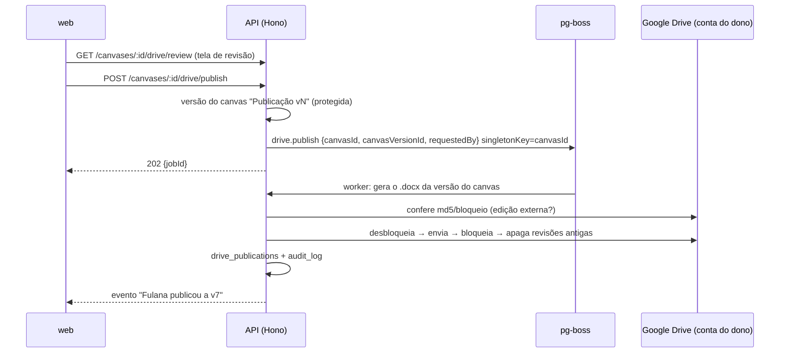

# Dicionário de dados em Word, publicado numa pasta do Google Drive: plano

> **Implementado** (fases 1 a 4; a fase 0 precisa de contas Google reais e roda com `pnpm drive:smoke`). As diferenças em relação ao plano estão no fim deste documento.
>
> Plano para gerar automaticamente, a partir do modelo do canvas, um documento Word com a estrutura e a formatação do modelo de referência `Modelo_Dados_CESS_Revisado.docx`, e publicá-lo numa pasta do Google Drive do dono do projeto. A aplicação é o **único caminho de edição** do arquivo: ele fica bloqueado, as reversões são feitas pelo histórico de versões do próprio app, e trocar de pasta exclui definitivamente o arquivo antigo. Escrito a partir do código atual (`packages/model`, `packages/crdt`, `apps/api`, `apps/web`) e do XML do documento de referência.

## Pedido e decisões registradas

| # | Pedido / decisão | Onde |
|---|---|---|
| 1 | **Google Drive**, na **conta Google do dono do projeto** (sem Google Workspace, drive compartilhado ou conta de serviço). | §2 |
| 2 | Botão para **salvar um .docx numa pasta escolhida**, com a **estrutura e a formatação** do documento de referência. | §1, §3 |
| 3 | **Conteúdo sempre gerado automaticamente** a partir do canvas. Ninguém edita o documento. Um **formulário** preenche só o que o SQL não preenche. | §1.4 |
| 4 | **Módulos vêm das tags do canvas** que começam com "Módulo" (ex.: "Módulo A — Cadastro e Pessoas"). Não ficam no formulário: aparecem numa **tela de revisão antes de publicar**, com os módulos e as informações derivadas, como confirmação. | §1.2, §3.1 |
| 5 | **Histórico só com metadados** (quem, quando, qual versão), sem guardar o .docx. | §7 |
| 6 | **Reverter pelo histórico de versões do app**, não pela lixeira do Google. | §4 |
| 7 | **Trocar a pasta:** cria na nova e **exclui definitivamente** na antiga. | §5 |
| 8 | A interface **avisa que reverter só deve ser feito pela aplicação**. | §8.1 |
| 9 | **Só o dono do projeto** conecta o Drive e escolhe ou troca a pasta. | §2 |
| 10 | Arquivo **bloqueado**: a aplicação é o gateway único de edição. | §2.2 |
| 11 | **Transferir a posse do projeto** para outro usuário. **Já existe** (Configurações do projeto → zona de perigo); o plano só acrescenta o que muda por causa do Drive. | §6 |

## Decisões principais (TL;DR)

| Tema | Escolha | Por quê |
|---|---|---|
| Conta e escopo | A conta Google **do dono do projeto**, com o escopo **`drive.file`** pedido só ao conectar | O app só enxerga a pasta escolhida no Picker e os arquivos que ele mesmo criou. É um escopo não sensível, então não exige auditoria de segurança do Google. |
| Escolha da pasta | **Google Picker** com seleção de pasta, aberto pelo dono | É o Picker que dá ao `drive.file` acesso à pasta escolhida. |
| Bloqueio | `contentRestrictions: readOnly` com **`ownerRestricted: true`** + vigilância | Ninguém além do dono do arquivo consegue tirar o bloqueio, e o dono do arquivo é o dono do projeto. Se ele desbloquear e editar pelo Drive, o app detecta, avisa e sobrescreve. Ver §2.2. |
| Publicar | **Atualiza o mesmo arquivo** (o link no Drive não muda): desbloqueia, envia, bloqueia de novo e **apaga as revisões antigas do Drive** | A única versão que existe no Drive é a atual; reverter só é possível pelo app. |
| Reverter | Restaura a **versão do canvas** ligada àquela publicação (o restaurar que já existe) e **publica de novo** | O documento é sempre o retrato do canvas. Cada publicação cria uma versão do canvas protegida. |
| Trocar pasta | Cria o arquivo na pasta nova → aponta o vínculo para ele → **exclui definitivamente** o antigo (`files.delete`, sem lixeira), com retentativa | Nunca há um momento sem documento publicado, e não sobra nada na pasta antiga para alguém restaurar. |
| Módulos | Tags que casam com `/^m[óo]dulo\s+(.+)$/i`. A descrição do módulo vem de uma **nota do canvas com o mesmo título da tag**, quando houver. | Reaproveita as tags (com filtro de visualização) e as notas que o canvas já tem. Nenhum conceito novo. |
| Gerar o .docx | Biblioteca **`docx`** (npm), num pacote novo **`packages/docx`** com uma função pura | Roda na API (publicação) e no navegador (pré-visualização e "Baixar .docx"). |
| Onde roda | **Jobs pg-boss na API**, com `singletonKey = canvasId` | A fila já existe (e-mails). Serializa publicação e troca de pasta do mesmo canvas entre réplicas, com retentativa. |



---

## Fluxos (visão geral)

**O canvas é a única fonte de verdade. O arquivo no Drive é só uma "foto" de uma versão do canvas.** O histórico fica no versionamento de canvas, que já existe. O Drive guarda só a foto mais recente.

### As três camadas

| Camada | O que é | Já existe? |
|---|---|---|
| **Canvas** | O modelo que todo mundo edita: canvas, SQL, Prisma, Drizzle, notas, tags e, agora, o formulário do documento (§1.4). | Sim |
| **Versões do canvas** | Cópias completas do canvas num momento: as que alguém salva com nome, uma automática por dia (as automáticas saem depois de 30 dias) e, agora, uma a cada publicação, protegida contra exclusão (§3.2). | Sim; só entra o tipo "publicação" |
| **Documento no Drive** | Um único arquivo .docx bloqueado, gerado a partir de uma versão do canvas. O Drive guarda só o atual (§3.2, passo 8). | Novo |

O **histórico de publicações** (§7) liga as duas últimas camadas. Cada linha diz "a v8 do documento foi gerada da versão X do canvas, por Fulana, em tal data". Só metadados.

### Os fluxos

1. **Editar o modelo**: como hoje. Mexer no canvas ou nos painéis de código não muda nada no Drive. O botão "Salvar no Drive" ganha um ponto de alerta quando o canvas está diferente da última publicação.
2. **Preencher o formulário** (capa, convenções, regras, funções das relações, descrições; §1.4): é uma edição do canvas como qualquer outra. Por isso também entra nas versões do canvas e não vai para o Drive sozinho.
3. **Publicar** (dono ou editor; §3):
   1. "Salvar no Drive" abre a tela de revisão (módulos, tabelas, pendências, pré-visualização).
   2. A pessoa confirma.
   3. O app salva uma versão do canvas "Publicação v8", protegida.
   4. Gera o .docx a partir dela e substitui o arquivo no Drive (mesmo arquivo, mesmo link).
   5. Registra no histórico de publicações.
4. **Voltar atrás** (§4): não é um mecanismo separado, é a soma de dois fluxos que já existem ou já estão acima.
   - **Restaurar uma versão do canvas** (já existe): muda só o canvas, para todos e com Ctrl+Z disponível. O Drive continua igual até alguém publicar.
   - **"Reverter para a publicação v5"** é um atalho: restaura a versão do canvas ligada à v5 e abre a tela de revisão. Ao confirmar, sai uma publicação nova (v9) com o conteúdo da v5.
5. **Trocar a pasta** (só o dono; §5): o mesmo conteúdo muda de lugar. O arquivo é criado na pasta nova e o antigo é excluído definitivamente. Nenhuma versão nova é criada; o histórico registra a troca.
6. **Transferir a posse** (já existe; §6): o documento continua sendo publicado no Drive do dono antigo até o novo dono conectar o Drive dele e escolher uma pasta. Daí roda o fluxo 5, só que entre contas.
7. **Vigilância** (automática; §8.2): se alguém editar ou desbloquear o arquivo pelo Drive, o app bloqueia de novo, avisa o dono e a próxima publicação sobrescreve. Pelo Drive não dá para "voltar versão", porque o app apaga as revisões antigas que o Drive guarda.

### Exemplo numa semana

| Dia | O que acontece | Versões do canvas | Drive |
|---|---|---|---|
| Seg | Edita e publica | + "Publicação v1" | v1 |
| Ter | Edita mais (sem publicar) | + automática do dia | v1, com alerta "mudanças não publicadas" |
| Qua | Publica | + "Publicação v2" | v2 |
| Qui | Restaura a versão automática de terça, só para conferir | — | v2 (nada muda) |
| Qui | Clica "Reverter para a v1" e confirma a revisão | + "Publicação v3" | v3, com o mesmo conteúdo da v1 |
| Sex | O dono troca a pasta | — | v3, agora na pasta nova; o arquivo da pasta antiga foi excluído |

O número da versão do documento **só sobe quando alguém publica** e nunca é reaproveitado. Por isso a reversão vira a v3, e não "volta a ser a v1".

**O que é novo de verdade** é o fluxo 3: tela de revisão, geração do .docx e envio. O fluxo 4 reaproveita o restaurar que já existe, e os fluxos 5 e 6 são variações de "criar num lugar, apagar no outro".

---

## 1. O documento

### 1.1 Especificação visual (medida no XML do documento de referência)

| Elemento | Valor |
|---|---|
| Página | A4 **paisagem** (16838 × 11906 twips). Margens: 794 em cima e embaixo, 680 nas laterais (≈1,4 cm e 1,2 cm). |
| Fonte padrão | Arial 9 pt (`sz=18`), espaçamento depois 10 pt, entrelinha 1,15. |
| Capa (sem estilo) | Linha 1: Arial 26 pt, negrito, `#0B5731`, centralizada, 50 pt de espaço antes. Linha 2: 16 pt, `#0F6F3D`, centralizada. Linha 3: 11 pt, centralizada. Depois, uma linha vazia e o parágrafo de escopo (10 pt). |
| Heading 1 | Arial 17 pt, negrito, `#0B5731`, **quebra de página antes**, 24 pt de espaço antes. Usado em "1. Convenções", "2. Índice de módulos", "Módulo X — …" e nos apêndices. |
| Heading 2 | Arial 13 pt, negrito, `#0F6F3D`. É o nome da tabela. |
| Heading 3 | Arial 11 pt, negrito, `#16834A`. Usado no título "Relacionamentos e função". |
| Parágrafo de descrição | Arial 9 pt, 4 pt de espaço depois. |
| Itens com marcador | O texto começa com "• " (o documento não usa lista numerada do Word), recuo de 227 twips, 8,5 pt, 2 pt de espaço depois. |
| Tabelas | Largura total de 15477 twips, **colunas iguais**, layout fixo, centralizadas, bordas simples pretas de 0,5 pt (`sz=4`) por dentro e por fora. Os parágrafos das células não têm espaçamento. |
| Cabeçalho das tabelas | Texto branco, negrito, 7,5 pt (`sz=15`). Fundo **`#0B5731`** nas tabelas de campos, de convenções, de módulos e nos apêndices; fundo **`#16834A`** nas tabelas de relacionamentos. |
| Corpo das tabelas | Arial 6,5 pt (`sz=13`), preto, sem preenchimento. **Linhas de colunas do tipo enum têm fundo `#EAF4EE`** (é assim em `type`, `memberFunction`, `status` e `action`). |
| Rodapé | Centralizado, Arial 9 pt: "`<Projeto>` — `<Título>`". O de referência não tem número de página. |
| Entre blocos | Um parágrafo vazio depois de cada tabela. |

> O arquivo de referência foi gerado pelo `python-docx` e passou pelo Google Docs (tem `customXML` do Docs). O gerador reproduz os **valores** acima, não o XML byte a byte. O arquivo de referência entra no repositório como fixture (`packages/docx/tests/fixtures/referencia.docx`), para o teste de fidelidade (§11).

### 1.2 Estrutura e origem de cada parte

Tudo é gerado: cada parte vem do modelo (o que SQL, Prisma, Drizzle e o canvas definem) ou do formulário (§1.4). Uma parte sem informação sai como "—" e aparece como **pendência** na tela de revisão.

| Seção do documento | Origem |
|---|---|
| Capa: título, subtítulo, linha 3, escopo | Formulário. A linha 3 aceita `{projeto}`, `{versao}` e `{data}` (padrão: "`{projeto}` — versão `{versao}`"). |
| **1. Convenções de modelagem**: parágrafo + tabela Convenção/Padrão/Objetivo | **Linhas detectadas** no modelo: padrão de PK, `uuid` único, colunas de auditoria (`created_at`/`updated_at`/`created_by`/`updated_by`), enum de status comum e tabelas que fogem do padrão (viram "Exceção X"). O formulário completa o **Objetivo** de cada linha e pode **acrescentar** convenções. O parágrafo de introdução também vem do formulário. |
| **2. Índice de módulos**: Módulo/Responsabilidade/Tabelas | **Tags de módulo** (abaixo). |
| **Módulo X** (Heading 1) + parágrafo | O texto da tag é o título. O parágrafo é o conteúdo de uma **nota do canvas cujo título é igual ao texto da tag** (o Markdown vira texto simples; listas viram marcadores "• "). Sem essa nota, não há parágrafo. |
| **Tabela** (Heading 2) | `Table.name`. |
| Parágrafo da tabela | `Table.comment` (vem do `COMMENT ON TABLE` do SQL ou do `///` do Prisma; quando falta, preenche-se no formulário, que grava no mesmo campo). |
| Marcadores "• …" | Gerados: cada **índice único parcial** ("Aplicar índice único parcial: UNIQUE(loginId) WHERE status = ACTIVE") e cada **CHECK**. Do formulário: **regras de negócio** da tabela, uma por linha. |
| Tabela de campos (9 colunas) | Uma linha por `Column` (§1.3). A descrição é o `Column.comment`, que pode ser preenchido pelo formulário. |
| **Relacionamentos e função** (Heading 3) + tabela de 5 colunas | Gerada das relações (§1.3). Só a coluna **Função** vem do formulário. |
| **Outras tabelas** | Tabelas sem tag de módulo entram num último módulo "Outras tabelas". A tela de revisão mostra quais são. |
| **Apêndice A — Resumo das restrições UNIQUE** | Por tabela: colunas `unique`, `Table.uniques` e índices únicos (os parciais com "via índice parcial"). |
| **Apêndice B — Resumo dos índices recomendados** | Por tabela: `Table.indexes` não únicos. |
| Rodapé | "`{projeto}` — `{título}`". |

**Tags de módulo:**
- Uma tag é de módulo quando casa com `/^m[óo]dulo\s+(.+)$/i`. O `X` é o resto, qualquer texto.
- **Coluna "Módulo" e "Responsabilidade" do índice:** se `X` tem um separador (` — `, ` - ` ou `:`), a parte antes vai para "Módulo" e a depois para "Responsabilidade". "Módulo A — Cadastro e Pessoas" → `Módulo A` | `Cadastro e Pessoas`. Sem separador, "Módulo" leva o texto inteiro da tag e "Responsabilidade" fica "—".
- **Ordem:** ordenação natural de `X` (A, B, C… ou 1, 2, 10).
- **Tabela com duas tags de módulo:** entra no primeiro módulo da ordem, e a tela de revisão avisa.
- Criar e atribuir módulos é o fluxo de tags que já existe no Inspector. O filtro de visualização por tag continua servindo para "ver só o Módulo B".

### 1.3 Regras de derivação das tabelas

**Tabela de campos:** `Campo | Descrição / note | Tipo | NULL? | PK | FK | Unique | Default | Índices / regras`

| Coluna | Regra |
|---|---|
| Campo | `Column.name`. |
| Descrição / note | `Column.comment`, ou "—". |
| Tipo | Nome **no estilo Prisma**, como no documento de referência: `bigint`→`BigInt`, `varchar(n)`→`VarChar(n)`, `timestamptz`→`Timestamptz`, `jsonb`→`JsonB`, `uuid`→`UUID`, `boolean`→`Boolean`, `integer`→`Int`, `date`→`Date`; enum → nome do enum; arrays → `Tipo[]`. Com a opção "tipos do Postgres" no formulário, sai `formatType`. O mapeamento fica em `packages/docx/src/types.ts` e reaproveita o que o gerador Prisma já sabe. |
| NULL? | "Sim" quando `nullable`, senão "Não". |
| PK | "Sim" se a coluna está em `primaryKey`. |
| FK | "`Tabela.coluna`" da FK em que a coluna participa (várias FKs separadas por "; "), ou "—". |
| Unique | "PK" se é a PK de uma coluna só; "Sim" se `unique` ou UNIQUE/índice único de uma coluna; "Composto" se participa de UNIQUE ou PK de várias colunas; "Parcial" se só está num índice único parcial; senão "Não". |
| Default | `identity` ou `serial` → `autoincrement`; `gen_random_uuid()` → `uuid()`; `now()`/`CURRENT_TIMESTAMP` → `now()`; literais sem as aspas SQL (`'ACTIVE'::status` → `ACTIVE`, `'{}'::jsonb` → `{}`); FK anulável sem default → `NULL`; nada → "—". |
| Índices / regras | Concatenação, separada por "; ": "PK; índice implícito." na PK; os valores do enum (`A \| B \| C`); `UNIQUE(...)`/`INDEX(...)` de cada índice que contém a coluna (os parciais com `WHERE`); `ON DELETE <AÇÃO>` da FK; "UNIQUE quando informado" em coluna única anulável. Sem nada, "—". |
| Fundo da linha | `#EAF4EE` quando o tipo é enum. |

**Tabela de relacionamentos:** `Relacionamento | Cardinalidade | FK / regra | ON DELETE | Função`

| Coluna | Regra |
|---|---|
| Relacionamento | "`A → B`", sempre a partir da tabela da seção: FKs de saída, FKs de entrada (vistas do lado "um") e relações-nota. Com mais de uma relação para a mesma tabela, entra o rótulo entre parênteses (ex.: "Project → User (cliente)"). Relação-nota ganha "(lógico)". |
| Cardinalidade | Na notação do documento (`1 : N`, `N : 1`, `N : 0..1`, `1 : 0..1`, `1 : 1`, `N : N`). FK de saída: `N : 1`; `N : 0..1` se a FK é anulável; `1 : 1` ou `1 : 0..1` se as colunas da FK são únicas. FK de entrada: o inverso. Relação-nota: a `cardinality` gravada, convertida. Pivot oculto: `N : N`. |
| FK / regra | "`Filha.col → Mãe.col`". Relação-nota: a ligação lógica entre as colunas. |
| ON DELETE | `onDelete` em maiúsculas (`CASCADE`, `SET NULL`, `RESTRICT`); "NO ACTION" quando ausente. Relação-nota: "Aplicação". |
| Função | Formulário: a função da relação **vista daquela tabela** (cada relação tem dois textos, um para cada lado). Relação-nota sem texto no formulário usa `label`/`reverseLabel`. Sem nada, "—". |

### 1.4 O formulário: o que o SQL não preenche

O documento é sempre gerado. O formulário só completa informação que o modelo não tem; não é um editor do documento. **Módulos não estão aqui:** vêm das tags (§1.2).

**Onde mora.** Numa **raiz nova do Y.Doc**, `doc`, ao lado de `meta`, `tables` etc., validada por zod em `packages/crdt`. Assim o formulário é colaborativo, entra nas **versões do canvas** (reverter também volta o formulário) e vai junto no `.zip` do projeto. SQL, Prisma e Drizzle não mudam.

```ts
interface DocContent {
  cover: { title: string; subtitle: string; edition: string; scope: string };
  intro: string;                                        // parágrafo da seção 1
  conventions: {
    detected: Record<string, { goal: string }>;         // Objetivo das linhas detectadas, pela chave da detecção
    extra: { name: string; pattern: string; goal: string }[];
  };
  tables: Record<TableId, { rules: string[] }>;         // marcadores de regra de negócio
  relationships: Record<RelId, { fromSide?: string; toSide?: string }>; // "Função" vista de cada lado
  typeStyle: 'prisma' | 'sql';
  fileName: string;                                     // "Modelo_Dados_{projeto}.docx"
}
```

- **Descrições de tabela e coluna** gravam em `Table.comment` e `Column.comment`, que já existem e voltam para o SQL como `COMMENT ON`. O que vem do SQL já aparece preenchido, com a marca "do SQL".
- **IDs estáveis:** regras e funções ficam presas ao ID da tabela ou da relação. O `reconcile` já preserva IDs quando reconhece renomeações. Quando uma tabela ou relação some, a entrada vira órfã e o formulário oferece "descartar".
- **Quem preenche:** quem tem `edit` (dono e editores), como qualquer outra parte do modelo.
- **Layout:** seções na ordem do documento (Capa → Convenções → por tabela: descrição, regras, descrição das colunas, função das relações). Tem o filtro "só o que falta", e cada tabela também é acessível pelo atalho "Preencher no documento" no Inspector.

### 1.5 O gerador (`packages/docx`)

```
packages/docx/src/
  index.ts        buildDataDictionary(project, content, meta) → { bytes, review }
  outline.ts      Project + DocContent → árvore intermediária (seções, linhas já como texto)
  modules.ts      tags de módulo → módulos ordenados, tabelas por módulo, conflitos
  derive.ts       regras de §1.3 e detecção de convenções
  render.ts       árvore → Document do `docx` (estilos, tabelas, rodapé)
  theme.ts        as constantes de §1.1 (cores, tamanhos, margens)
```

- **Duas etapas.** `outline` produz uma estrutura simples (`{ kind: 'table', header, rows, fill }`...), que é o que os testes de regra comparam e o que a tela de revisão mostra. `render` só formata.
- **`review`** é o resumo para a tela de revisão (§3.1): módulos com suas tabelas, "Outras tabelas", conflitos (tabela em dois módulos, tag de módulo sem tabela), contagens e pendências.
- **Determinístico** com a mesma entrada (as datas de `docProps/core.xml` vêm de `meta.publishedAt`), o que permite pular publicações sem mudança.
- No navegador, roda num Web Worker (como o `parser.worker`), para a pré-visualização e o "Baixar .docx".

---

## 2. Conexão e bloqueio (conta do dono)

### 2.1 Conectar e escolher a pasta (só o dono)

1. **Conectar:** o dono clica "Conectar Google Drive" em **Configurações do projeto → Documento**. Vai para `authClient.linkSocial({ provider: 'google', scopes: ['https://www.googleapis.com/auth/drive.file'], callbackURL })`. Funciona tanto para quem entrou com e-mail e senha quanto para quem já entrou com Google.
   - Ajustes no `createAuth`: `google: { ..., accessType: 'offline', prompt: 'consent' }` (para receber o *refresh token*), `account.encryptOAuthTokens: true` (tokens cifrados em `accounts`, com um script único que migra os atuais) e `accountLinking.allowDifferentEmails: true` (a conta do Drive pode ter outro e-mail).
   - No servidor, `auth.api.getAccessToken({ body: { providerId: 'google', userId: dono } })` entrega um token válido e renova sozinho. **Todas as operações no Drive usam o token do dono**, não importa quem apertou "Salvar no Drive": com `drive.file`, só a conta que criou o arquivo e escolheu a pasta tem acesso a eles.
2. **Escolher a pasta:** `GET /api/projects/:id/drive/picker-token` (só o dono) → Google Picker com `DocsView(ViewId.FOLDERS)`, `setSelectFolderEnabled(true)`, `setEnableDrives(true)` e `setAppId(GOOGLE_PROJECT_NUMBER)`. O `setAppId` é obrigatório: é ele que dá acesso à pasta.
3. **Verificar:** `files.get(folderId, fields: 'id,name,mimeType,driveId,capabilities(canAddChildren)')` confirma que é pasta e que o dono pode criar arquivos nela. A API guarda o nome e o caminho para a interface e enfileira a primeira publicação.

Variáveis novas no `env.ts`: `GOOGLE_PICKER_API_KEY` (restrita por *referrer* ao `APP_URL`) e `GOOGLE_PROJECT_NUMBER`. A funcionalidade só aparece com essas e o `GOOGLE_CLIENT_ID`. O `web` continua sem variáveis de build: lê o que precisa de `GET /api/drive/config`. No Google Cloud: ativar a Drive API e a Picker API e adicionar `drive.file` na tela de consentimento.

### 2.2 O bloqueio

Todo arquivo é criado já bloqueado:

```jsonc
{
  "name": "Modelo_Dados_CESS.docx",
  "parents": ["<folderId>"],
  "mimeType": "application/vnd.openxmlformats-officedocument.wordprocessingml.document", // sem converter para Google Docs
  "appProperties": { "erdCanvasId": "...", "erdProjectId": "..." },
  "description": "Gerado pelo ERD Builder. Não edite nem reverta pelo Drive: use o histórico do app.",
  "writersCanShare": false,
  "contentRestrictions": [{ "readOnly": true, "ownerRestricted": true,
    "reason": "Documento gerado pelo ERD Builder. Edições e reversões só pelo app." }]
}
```

**Quem consegue o quê:**

| Pessoa | Editar o conteúdo | Tirar o bloqueio | Mover / apagar |
|---|---|---|---|
| Outros membros com acesso à pasta (mesmo como Editor do Drive) | ✘ | ✘ (`ownerRestricted`) | Mover para outra pasta dele: depende do acesso; apagar: ✘ (só o dono do arquivo) |
| **Dono do projeto** (dono do arquivo) | Só depois de desbloquear | ✔ (é o dono) | ✔ |

O dono do arquivo é sempre o dono do projeto. Como isso foi aceito no lugar de um drive compartilhado, o que ele fizer pelo Drive é coberto pela vigilância, e não impedido:
- **Antes de cada publicação** e no job `drive.audit` (a cada 6 h), o app confere o `md5Checksum`, o `headRevisionId`, o bloqueio, a lixeira e as pastas do arquivo.
- **Edição externa:** registra `external_edit_detected` com `lastModifyingUser`, avisa o dono (sininho e e-mail) e **a próxima publicação sobrescreve**. O app não republica sozinho, para a pessoa ver o aviso antes.
- **Bloqueio retirado:** bloqueia de novo (`relocked`).
- **Arquivo na lixeira ou apagado:** a próxima publicação recria e registra `recreated`. **Arquivo movido:** o app devolve à pasta configurada.
- Depois de criar, o app confere `capabilities.canModifyOwnerContentRestriction`. Se o bloqueio não ficou como pedido, a publicação falha com uma mensagem clara, em vez de deixar um arquivo desbloqueado.

### 2.3 Permissões (`packages/contracts/src/permissions.ts`)

| Ação | owner | editor | viewer |
|---|:-:|:-:|:-:|
| `driveConfigure`: conectar, escolher/trocar pasta, desconectar | ✔ | ✘ | ✘ |
| Preencher o formulário (é `edit`, como o resto do modelo) | ✔ | ✔ | ✘ |
| `drivePublish`: revisar e publicar, reverter para uma publicação | ✔ | ✔ | ✘ |
| Ver status, histórico, pré-visualização; baixar o .docx | ✔ | ✔ | ✔ |

---

## 3. Publicar

### 3.1 Tela de revisão (confirmação antes de enviar)

"Salvar no Drive" abre a tela **"Revisar e publicar"**, montada a partir do `review` do gerador (§1.5). Nada é enviado antes de a pessoa confirmar.

- **Módulos:** uma árvore com cada tag de módulo (na ordem e com a letra/identificador que vão para o documento), a responsabilidade, a nota de descrição usada (ou "sem nota") e as tabelas de cada um, com contagem de colunas e relações. Também mostra "Outras tabelas" (sem módulo), **conflitos** (tabela em dois módulos: "entrou no Módulo A") e tags de módulo sem nenhuma tabela.
- **Derivado:** número de tabelas, colunas, relações e enums; convenções detectadas; o que mudou desde a última publicação (tabelas e colunas adicionadas, removidas ou alteradas, com o mesmo diff do toast de sync).
- **Pendências:** contagem e lista (tabelas sem descrição, colunas sem descrição, relações sem função, convenções sem objetivo), cada uma com link para o formulário. Dá para publicar com pendências; a tela só avisa.
- **Destino:** pasta atual, nome do arquivo, número da versão que vai ser criada ("v8") e o aviso do §8.1.
- **Pré-visualização** do documento (HTML a partir do `outline`, com o mesmo visual) e "Baixar .docx".
- Botões: **"Publicar v8 no Drive"** e "Voltar ao formulário".

A tela registra o `contentHash` do que foi revisado. Se o canvas mudar enquanto a tela está aberta, aparece "o modelo mudou, atualizar revisão", e o publicar só aceita o hash revisado. Assim, o que vai para o Drive é exatamente o que a pessoa confirmou.

### 3.2 O fluxo

`POST /api/canvases/:id/drive/publish { reviewedHash }` → `requireCan('drivePublish')`:

1. Lê o estado atual do canvas (`deps.writer.read`) e calcula o `contentHash`. Se for diferente de `reviewedHash`, responde 409 ("o modelo mudou, revise de novo"). Se for igual ao da última publicação, responde "nada mudou desde a v7".
2. **Cria uma versão do canvas** "Publicação v8 no Drive" (`canvas_versions`, `createdBy` = quem pediu). É ela que permite reverter (§4). Essas versões são **protegidas**: não contam no `MAX_VERSIONS_PER_CANVAS`, não são podadas e não podem ser apagadas no diálogo de versões.
3. Enfileira `drive.publish { canvasId, canvasVersionId, requestedBy }` com `singletonKey = canvasId` e responde `202 { jobId }`.

O worker:

4. **Gera o .docx** a partir da versão do canvas (não do estado "ao vivo"), com `version = última + 1`.
5. **Pega o token do dono.** Se falhar (`invalid_grant`, conta desvinculada), o vínculo vai para `needs_reconnect`, o dono é avisado e o job termina sem retentar.
6. **Confere o arquivo atual** (§2.2): edição externa, bloqueio, lixeira, pasta.
7. **Grava:**
   - Primeira vez ou arquivo sumido: `files.create` (multipart), já bloqueado.
   - Arquivo existente: tira o bloqueio → `files.update` com o conteúdo (e o nome, se `fileName` mudou) → bloqueia de novo. O bloqueio roda num `finally`; se até ele falhar, o vínculo fica `lock_pending` e o `drive.audit` repara. A janela sem bloqueio dura poucos segundos.
8. **Apaga as revisões antigas do Drive** (`revisions.list` → `revisions.delete` em todas menos a atual). Assim, o "Gerenciar versões" do Drive não oferece um caminho paralelo de reversão: a única versão no Drive é a publicada. Se a fase 0 mostrar que `drive.file` não permite apagar revisões, o passo vira "best effort" e o aviso do §8.1 cobre o resto.
9. **Registra**, numa transação: `drive_publications` (`published`, versão, md5, revisão, `canvasVersionId`, quem pediu), `drive_bindings` atualizado e `audit_log`.
10. **Avisa** quem está no canvas: `deps.events.broadcast(canvasId, { type: 'drivePublished', by, version })`, com o toast "Fulana publicou a v8 no Drive" e link para o arquivo (o link é estável, porque o arquivo é sempre o mesmo).

**Erros:** 429 e 5xx do Google → retentativa do pg-boss (backoff exponencial, até 5 vezes). 403 na pasta → `needs_folder` e aviso ao dono. Toda falha definitiva vira uma linha `failed` no histórico, com o motivo.

**Publicação automática (opcional, fase 4):** "Publicar ao salvar uma versão nomeada" enfileira o mesmo fluxo sem a tela de revisão. Fica desligado por padrão, já que a revisão foi pedida como confirmação.

---

## 4. Reverter (pelo histórico do app)

Cada publicação está ligada a uma versão do canvas (§3.2, passo 2), então reverter é **restaurar essa versão e publicar de novo**:

1. No histórico de publicações, "Reverter para a v5" mostra a confirmação: "**O canvas** volta ao estado da v5 para todos (dá para desfazer com Ctrl+Z), e depois o documento é publicado como **v9** com esse conteúdo."
2. O cliente aplica a versão do canvas com o `restoreVersion` que já existe: diff aplicado como edição comum, ao vivo para todos e desfazível. O formulário (raiz `doc`) volta junto.
3. Abre a tela de revisão (§3.1) já com o conteúdo restaurado, mostrando "revertendo da v5". Na confirmação, segue o fluxo normal de publicação, e o histórico registra `published` com `revertedFrom: 5`.

Uma versão aparece como **"Indisponível"** só se a versão do canvas dela tiver sido apagada (por exemplo, com o canvas excluído). Como elas são protegidas, isso não acontece pelo uso normal.

---

## 5. Trocar a pasta (exclusão definitiva na antiga)

`PUT /api/canvases/:id/drive/folder { folderId }` → `requireCan('driveConfigure')` → job `drive.relocate` (mesmo `singletonKey`, então nunca roda junto com uma publicação do mesmo canvas).

1. Verifica a pasta nova (§2.1, passo 3). Se for a mesma pasta, não faz nada.
2. Confirmação na interface: "O documento será criado em *Nova*, e o arquivo em *Antiga* será **excluído definitivamente** (não vai para a lixeira e não pode ser recuperado pelo Drive). O histórico continua no app."
3. **Cria o arquivo na pasta nova** a partir da última versão publicada (a mesma versão do canvas, sem número novo), já bloqueado. Se falhar, nada muda.
4. **Numa transação:** o vínculo passa a apontar para a pasta e o arquivo novos; o histórico registra `folder_changed` (pasta antiga → nova, quem pediu); e o arquivo antigo entra em **`drive_pending_deletions`**.
5. **Exclusão definitiva:** tira o bloqueio (se a fase 0 mostrar que é preciso) e chama `files.delete` (permanente, sem lixeira). Um 404 conta como sucesso. Depois, uma busca na pasta antiga por arquivos do app (`appProperties has { key='erdCanvasId' and value='…' }`, incluindo os que estão na lixeira) garante que não sobrou nenhum.
6. **Se falhar:** o job `drive.cleanup` tenta de novo com backoff (até 24 h). Enquanto isso, a interface mostra "O arquivo antigo em *Antiga* ainda não foi excluído". Depois do limite, o aviso vira "exclua manualmente", com link. O vínculo já está na pasta nova, então o app nunca considera dois documentos ativos.

**Desconectar:** pergunta se quer **excluir definitivamente** o documento do Drive (padrão) ou deixá-lo lá, bloqueado e "congelado". O histórico continua.

---

## 6. Transferência de posse do projeto

**Já existe:** Configurações do projeto → zona de perigo → "Transferir a posse para outro membro (você vira editor)". A rota é `POST /api/projects/:id/transfer`, que só aceita membros do projeto, troca os papéis numa transação e avisa as conexões abertas por `permissionChanged`. O plano acrescenta:

1. **Drive na transferência.** O documento está no Drive do dono antigo, e o novo dono não tem acesso a ele com o `drive.file` dele. Então:
   - A confirmação da transferência avisa: "O documento está no Google Drive de Fulana. Depois da transferência, **Beltrano** precisa conectar o Drive dele e escolher uma pasta; o documento será criado lá e o arquivo no Drive de Fulana será excluído definitivamente."
   - O vínculo vai para `transfer_pending`. **As publicações continuam** no destino antigo, com o token do dono antigo (que agora é editor), para a equipe não ficar parada.
   - Quando o novo dono conecta e escolhe a pasta, roda o mesmo fluxo do §5: cria com o token do novo dono e exclui o antigo com o token do dono antigo. `drive_pending_deletions` guarda de quem é o token a usar.
   - Se o dono antigo sair do projeto ou revogar o acesso antes disso, as publicações param (`needs_reconnect`, aviso ao novo dono), e o arquivo antigo fica para exclusão manual, com o link na tela.
2. **Aviso ao novo dono:** notificação no sininho e por e-mail ("Fulana transferiu o projeto X para você"), que hoje não é enviada. Entra como um tipo novo em `notify.ts` e no template de `packages/emails`, respeitando as preferências de e-mail.
3. **Teste E2E** da transferência com Drive conectado, usando o provider falso.

---

## 7. Histórico (só metadados)

Tabelas novas em `packages/db/src/schema/app.ts` (migração gerada com `pnpm db:generate`). Nenhuma guarda bytes do .docx.

```ts
/** Um vínculo por canvas: onde o documento está publicado */
export const driveBindings = pgTable('drive_bindings', {
  canvasId: text('canvas_id').primaryKey().references(() => canvases.id, { onDelete: 'cascade' }),
  projectId: text('project_id').notNull().references(() => projects.id, { onDelete: 'cascade' }),
  connectedUserId: text('connected_user_id').references(() => users.id), // dono do arquivo no Drive
  folderId: text('folder_id').notNull(),
  folderName: text('folder_name').notNull(),
  folderPath: text('folder_path'),
  fileId: text('file_id'),
  fileName: text('file_name'),
  webViewLink: text('web_view_link'),
  lastRevisionId: text('last_revision_id'),
  lastMd5: text('last_md5'),
  lastContentHash: text('last_content_hash'),
  lastVersion: integer('last_version').notNull().default(0),
  lock: text('lock').notNull().default('none'),     // none | locked | pending
  status: text('status').notNull().default('active'),
  // active | needs_reconnect | needs_folder | transfer_pending | paused
  createdAt: created(),
  updatedAt: ts('updated_at').notNull().defaultNow(),
});

/** Append-only: cada publicação, troca de pasta ou evento observado no Drive */
export const drivePublications = pgTable('drive_publications', {
  id: text('id').primaryKey(),
  canvasId: text('canvas_id').notNull().references(() => canvases.id, { onDelete: 'cascade' }),
  action: text('action').notNull(),
  // published | unchanged | failed | folder_changed | recreated | external_edit_detected
  // | moved_externally | relocked | disconnected | owner_transferred
  version: integer('version'),                    // "versão N" da capa (só em published)
  revertedFrom: integer('reverted_from'),         // published vindo de reversão
  canvasVersionId: text('canvas_version_id').references(() => canvasVersions.id, { onDelete: 'set null' }),
  requestedBy: text('requested_by').references(() => users.id), // quem pediu no app (null = job automático)
  fileId: text('file_id'),
  driveRevisionId: text('drive_revision_id'),
  md5: text('md5'),
  sizeBytes: integer('size_bytes'),
  contentHash: text('content_hash'),
  folderId: text('folder_id'),
  folderName: text('folder_name'),
  previousFolderId: text('previous_folder_id'),   // folder_changed
  previousFolderName: text('previous_folder_name'),
  previousFileId: text('previous_file_id'),
  oldFileDeletedAt: ts('old_file_deleted_at'),
  externalActor: jsonb('external_actor').$type<{ name?: string; email?: string }>(), // lastModifyingUser do Drive
  error: text('error'),
  createdAt: created(),
}, (t) => [index('drive_publications_canvas_idx').on(t.canvasId, t.createdAt)]);

/** Arquivos a excluir definitivamente, com retentativa e o token de quem usar */
export const drivePendingDeletions = pgTable('drive_pending_deletions', {
  fileId: text('file_id').primaryKey(),
  canvasId: text('canvas_id').notNull(),
  tokenUserId: text('token_user_id').references(() => users.id),
  attempts: integer('attempts').notNull().default(0),
  lastError: text('last_error'),
  createdAt: created(),
});
```

- **O que fica guardado:** quem publicou, reverteu ou trocou a pasta; quando; o número da versão; a pasta; o ID, o md5, o tamanho e a revisão do arquivo; a versão do canvas que o originou; e quem editou por fora, quando o Drive informa.
- **O que não fica:** o conteúdo do .docx. Ele pode ser gerado de novo a partir da versão do canvas, que já é parte do app.
- A coluna `canvas_versions.protected` (boolean) marca as versões de publicação, para não serem podadas nem apagadas (§3.2).

---

## 8. Gateway único: avisos e vigilância

### 8.1 Avisos na interface

Texto padrão: **"Este documento é gerado pelo app. Para reverter, use o histórico de publicações daqui. Não edite nem restaure versões pelo Google Drive: isso cria conflitos com o que o app publica, e a próxima publicação sobrescreve."**

Esse aviso aparece:
- no diálogo do documento, fixo, logo abaixo do link "Abrir no Drive";
- no topo do histórico de publicações;
- na tela de revisão (§3.1) e nas confirmações de reverter, trocar pasta e transferir a posse;
- no próprio Drive, na `description` do arquivo e na `reason` do bloqueio, que o Drive mostra a quem tenta editar.

Para o **dono**, que é o único que consegue desbloquear, o diálogo também mostra: "Você é o dono do arquivo no Drive e consegue desbloqueá-lo por lá. Não faça isso: o app vai detectar, avisar e sobrescrever."

### 8.2 Vigilância (`drive.audit`, a cada 6 h, e antes de cada publicação)

- Confere existência, lixeira, pasta, md5 e bloqueio do arquivo atual (§2.2), e repara o que dá: bloqueia de novo, devolve à pasta, recria na próxima publicação.
- Revisões novas que o app não criou → `external_edit_detected`, com quem fez.
- Toda anomalia vira notificação para o dono (sininho e e-mail, desligável em `/settings`) e uma faixa no diálogo do documento.
- Custo: uma chamada à Drive API por vínculo a cada 6 h.

---

## 9. API e front-end

### 9.1 Rotas (`apps/api/src/routes/drive.ts`)

| Rota | Permissão | O quê |
|---|---|---|
| `GET /api/drive/config` | logado | `{ enabled, pickerApiKey, appId, clientId }` |
| `GET /api/projects/:id/drive` | `view` | Conta conectada (nome/e-mail do Google), vínculos por canvas com status. |
| `GET /api/projects/:id/drive/picker-token` | `driveConfigure` | Token curto do dono para o Picker. |
| `PUT /api/canvases/:id/drive/folder` | `driveConfigure` | Primeira escolha (cria o vínculo; a primeira publicação passa pela tela de revisão) ou troca de pasta (§5). |
| `DELETE /api/canvases/:id/drive` | `driveConfigure` | Desconectar. |
| `GET /api/canvases/:id/drive/review` | `view` | O `review` do gerador + `contentHash` + diff desde a última publicação. |
| `POST /api/canvases/:id/drive/publish` | `drivePublish` | `{ reviewedHash, revertedFrom? }` (§3.2). |
| `GET /api/canvases/:id/drive/publications` | `view` | Histórico paginado, com nomes. |
| `GET /api/canvases/:id/drive/jobs/:jobId` | `view` | Estado do job. O evento por WebSocket também chega. |
| `GET /api/canvases/:id/docx` | `export` | Gera e baixa o .docx na hora, sem Drive. |

Organização no código:
- `packages/contracts/src/dto.ts`: `DocContentZ`, `DocReviewZ`, `DriveBindingZ`, `DrivePublicationZ`, `PublishZ`.
- `apps/api/src/drive/`:
  - `google.ts`: chamadas da Drive API v3 com `fetch` (sem o `googleapis`, que é pesado), sempre com `supportsAllDrives=true` (a pasta pode estar num drive compartilhado da pessoa), e upload multipart (*resumable* acima de 5 MB).
  - `jobs.ts`: workers `drive.publish`, `drive.relocate`, `drive.cleanup` e `drive.audit` na mesma instância pg-boss do `mailQueue` (extrair um `queue.ts` compartilhado).
  - `token.ts`: `getAccessToken` do Better Auth com tratamento de `invalid_grant`.
- Métricas em `/metrics`: `drive_publish_total{status}`, `drive_publish_seconds`, `drive_external_edits_total`, `drive_pending_deletions`.
- Nunca logar tokens.

### 9.2 Interface (`apps/web`)

- **Botão "Salvar no Drive"** no `Header` do editor, ao lado do histórico, quando há vínculo. Estados: "Salvar no Drive", "Publicando…" e "v8 · há 2 min" (abre o arquivo). Um ponto indica "há mudanças não publicadas" (compara o `contentHash` local, calculado no worker, com o da última publicação). Clicar abre a **tela de revisão** (§3.1).
- **Diálogo "Documento Word"** (Configurações do projeto e menu do canvas):
  - **Formulário** (§1.4), com pendências e filtro "só o que falta", e a pré-visualização ao lado.
  - **Aba "Drive"**: conectar, conta conectada, pasta atual com "Trocar pasta…" (só o dono), status do bloqueio e o aviso do §8.1. Membros que não são donos veem tudo sem os botões.
- **Histórico de publicações:** aba no `VersionsDialog` ("Versões do canvas" | "Publicações no Drive"). Cada linha mostra a versão, quem publicou, quando, a pasta e "Reverter" (§4). Eventos como troca de pasta, edição externa (com quem editou no Drive), recriação e falha aparecem intercalados, com ícone próprio. No outro lado, as versões de publicação aparecem em "Versões do canvas" com um cadeado (protegidas).
- **Inspector:** atalho "Preencher no documento" quando a tabela selecionada tem pendências.
- **Transferência** (zona de perigo): o aviso do §6 quando há Drive conectado.
- **Modo `/local`:** formulário, tela de revisão, pré-visualização e "Baixar .docx", sem Drive.

---

## 10. Fases de entrega

Cada fase pode ir para produção sozinha.

| Fase | Entrega | Pronto quando |
|---|---|---|
| **0. Prova no Drive real** (1 dia) | Um script com uma conta Google de teste e o escopo `drive.file` confirma o comportamento que o plano assume: (a) criar com `contentRestrictions` + `ownerRestricted` no `files.create`; (b) outra conta, com acesso de Editor à pasta, não consegue editar nem desbloquear; (c) tirar o bloqueio, enviar e bloquear de novo; (d) `revisions.delete` em arquivo binário; (e) `files.delete` permanente de um arquivo bloqueado; (f) o Picker concede acesso à pasta. | Cada item confirmado ou com a alternativa registrada neste documento. |
| **1. Gerador, formulário e revisão** | `packages/docx`, raiz `doc` no Y.Doc, módulos por tag, formulário com pendências, tela de revisão, pré-visualização e "Baixar .docx" (web, `/local` e `GET /canvases/:id/docx`). | O teste de fidelidade passa e o .docx da fixture CESS abre no Word e no Google Docs igual à referência. **Aqui já dá para validar o formato com quem usa.** |
| **2. Drive** | Conectar e Picker do dono, bloqueio, `drive.publish` com revisão confirmada, versões do canvas protegidas, histórico, reverter (§4), botão e toast, avisos do §8.1. | Publicar cria e atualiza o arquivo bloqueado; outra conta não consegue editar; reverter traz o canvas e publica de novo. |
| **3. Troca de pasta, transferência e vigilância** | `drive.relocate` com exclusão definitiva, `drive_pending_deletions`, `drive.cleanup`, transferência com Drive (§6), notificação ao novo dono, `drive.audit`. | Trocar de pasta deixa um só arquivo; transferir leva o documento para o Drive do novo dono; uma edição externa é detectada e avisada. |
| **4. Acabamento** | Métricas, `pnpm drive:smoke`, publicação automática opcional, documentação de configuração do Google Cloud no README. | — |

## 11. Testes

| Nível | O quê |
|---|---|
| Unitário (`packages/docx`) | Regras de §1.3 em `outline`. Módulos: casamento da tag (acento, maiúsculas), separadores, ordenação natural, tabela em dois módulos, tag sem tabela, nota de descrição. Detecção de convenções e lista de pendências. Propriedade (fast-check): toda tabela e coluna aparece exatamente uma vez, e a mesma entrada gera os mesmos bytes. |
| **Fidelidade ao documento de referência** | Uma fixture `cess.sql` (com as tags "Módulo A — Cadastro e Pessoas" etc. via `-- @erd:tags`) + `cess.doc.json` (o formulário preenchido) reconstrói o documento. O teste gera o .docx, abre o XML (`jszip`) e compara com a referência: títulos, quantidade de tabelas e linhas, conteúdo das células (normalizado), cores por tipo de tabela e de linha, tamanhos de fonte, página e margens, quebra de página no Heading 1 e rodapé. Diferenças esperadas ficam numa lista explícita. |
| Visual (CI) | `soffice --headless --convert-to pdf` do gerado e da referência, renderizados em PNG (capa, página 3 e Módulo B), com comparação por limiar. |
| Integração (API) | `DriveProvider` falso em memória que imita o Google, incluindo `contentRestrictions` (recusar update com `readOnly`), md5, revisões, lixeira, 404 e 429. Casos: primeira publicação; "sem mudanças"; `reviewedHash` desatualizado (409); edição externa detectada e sobrescrita; arquivo apagado ou movido por fora; reverter (versão protegida, `revertedFrom`); trocar pasta (com falha no create, nada muda; com falha no delete, fica pendente e o cleanup resolve); transferência com publicações seguindo no destino antigo e depois a troca para o Drive do novo dono; token revogado; concorrência (o `singletonKey` serializa); permissões por papel. |
| Contrato (staging) | `pnpm drive:smoke` com duas contas Google de teste (dono e Editor da pasta). Repete a fase 0 e o ciclo publicar → reverter → trocar pasta. Não roda no CI (precisa de credencial real). |
| E2E (Playwright) | Com `DRIVE_PROVIDER=fake`: criar tags de módulo, ver a tela de revisão, preencher pendências, publicar, ver o toast em outro navegador, reverter, trocar pasta, transferir a posse. O Picker vira um seletor simples no modo fake. |

## 12. Riscos e mitigação

| Risco | Mitigação |
|---|---|
| O dono desbloqueia e edita pelo Drive | É o único que consegue (o arquivo é dele). Aviso fixo para ele (§8.1), detecção a cada publicação e a cada 6 h, re-bloqueio, notificação, sobrescrita na próxima publicação e registro de quem editou. |
| Token do dono expira ou é revogado | `getAccessToken` renova; com `invalid_grant`, o status vira `needs_reconnect` e o dono recebe sininho e e-mail. As publicações pedidas nesse meio tempo falham com uma mensagem clara. |
| Falha entre desbloquear e bloquear de novo | Bloqueio no `finally`, `lock='pending'` e reparo pelo `drive.audit`. A janela é de poucos segundos e só outras contas com acesso à pasta poderiam aproveitá-la. |
| Transferência com o dono antigo indisponível | As publicações param com aviso ao novo dono, e o arquivo antigo fica para exclusão manual com link (§6). |
| Versões de publicação ocupam espaço | Só são criadas quando o conteúdo muda (`contentHash`). O estado compactado de um canvas de 200 tabelas tem centenas de KB. |
| Tags de módulo inconsistentes ("Modulo A" e "Módulo A") | O casamento ignora acento e maiúsculas e trata as duas como o mesmo módulo; a tela de revisão mostra a grafia usada e avisa sobre a variação. |
| Documento grande (200+ tabelas) | O `docx` gera centenas de páginas em menos de um segundo no Node; upload *resumable* acima de 5 MB; métrica `drive_publish_seconds`. |
| Fidelidade visual diferente entre Word, LibreOffice e Google Docs | Usar só recursos que a referência já usa (sem campos, sem listas numeradas, sem estilos de tabela complexos) e o teste visual. |

## Diferenças em relação ao plano (implementação)

- **Fase 0** não foi executada aqui (precisa de duas contas Google reais). O script `pnpm drive:smoke` faz os itens (a) a (e) e o ciclo de troca de pasta; o item (f), o Picker, é manual. O código já trata as duas alternativas que a fase 0 poderia apontar: apagar revisões antigas é "best effort" (falha só gera log), e a exclusão definitiva tenta de novo depois de desbloquear se o Drive recusar por causa da restrição.
- **Fidelidade:** o `Modelo_Dados_CESS_Revisado.docx` não está no repositório. O teste de fidelidade (`packages/docx/tests/fidelity.test.ts`) gera o documento da fixture CESS (`cess.sql` + `cess.doc.json`) e compara o XML com os **valores medidos** do §1.1 (página, margens, fontes, cores por tipo de tabela e de linha, quebra de página no Heading 1, larguras, rodapé). O teste visual virou uma conversão no LibreOffice (`soffice --convert-to pdf`, roda quando o `soffice` existe) que confere que o arquivo abre e tem as páginas esperadas; a comparação por imagem com a referência entra quando o arquivo de referência for versionado.
- **`@erd:tags` com aspas:** tags com espaço (as de módulo) saem entre aspas nos três formatos (`-- @erd:tags orders "Módulo B — Pedidos"`), e o Inspector preserva a grafia de tags que começam com "Módulo".
- **Formulário no Y.Doc:** a raiz `doc` é achatada (uma chave por campo, LWW por campo) e validada por zod; o documento sem formulário projeta sem `doc`.
- **Hash revisado:** a tela de revisão calcula o `contentHash` no worker do navegador (o mesmo código da API); a API recalcula e recusa (409) se não bater.
- **Desconectar** não apaga o vínculo: ele fica `paused` (sem arquivo), para a numeração das versões continuar ao escolher uma pasta de novo.
- **Avisos sem repetição:** `drive_bindings.anomaly` guarda a última anomalia avisada; a auditoria de 6 h não repete o mesmo aviso. Os avisos usam a preferência de e-mail nova "Avisos do documento no Google Drive"; a notificação de transferência de posse usa a de "membros".
- **`drive_pending_deletions`** ganhou `folder_id`, `folder_name`, `next_attempt_at` e `gave_up_at` (a interface mostra "exclua manualmente" depois de 24 h). A varredura roda a cada 10 min.
- **Uma fila só:** todos os jobs do Drive estão na fila `drive` (política `singleton` do pg-boss com `singletonKey = canvasId`), na mesma instância pg-boss dos e-mails, para publicação, troca de pasta, limpeza e desconexão do mesmo canvas nunca rodarem juntas.
- **Drive falso no E2E:** `DRIVE_PROVIDER=fake` é aceito também nas imagens de produção, desde que o `APP_URL` não seja HTTPS (o E2E do CI roda contra `http://localhost:8081`).
- **Publicação automática** (fase 4): `drive_bindings.auto_publish`, ligada pelo dono na aba Drive; salvar uma versão nomeada enfileira a publicação sem a tela de revisão.
