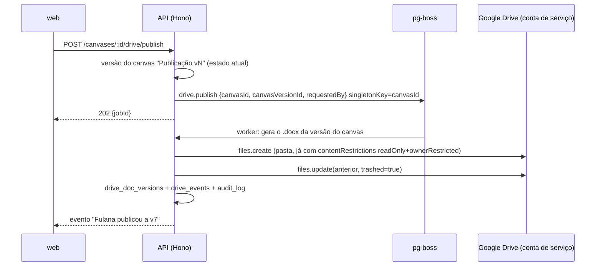

# Dicionário de dados em Word, publicado numa pasta do Google Drive: plano

> Plano para gerar automaticamente, a partir do modelo do canvas, um documento Word com a estrutura e a formatação do modelo de referência `Modelo_Dados_CESS_Revisado.docx`, e publicá-lo numa pasta escolhida do Google Drive. A aplicação é o **único caminho de edição** do arquivo: ele fica bloqueado para todas as pessoas, cada publicação deixa a versão anterior na lixeira (de onde o app consegue reverter), e trocar de pasta exclui definitivamente o que ficou na pasta antiga. Escrito a partir do código atual (`packages/model`, `packages/crdt`, `apps/api`, `apps/web`) e do XML do documento de referência.

## Pedido e decisões registradas

| # | Pedido / decisão | Onde |
|---|---|---|
| 1 | **Google Drive.** | §2 |
| 2 | Botão para **salvar um .docx numa pasta escolhida** do Drive, com a **estrutura e a formatação** do documento de referência. | §1, §3 |
| 3 | **Conteúdo sempre gerado automaticamente** a partir do canvas. Ninguém edita o documento. A interface tem um **formulário para preencher o que o SQL não preenche** (capa, convenções, módulos, regras, descrições, função das relações). | §1.4, §8 |
| 4 | **Histórico só com metadados** (quem, quando, qual arquivo), sem guardar o conteúdo do .docx. | §6 |
| 5 | Cada atualização manda a versão anterior para a **lixeira**. O histórico permite **reverter a partir do arquivo na lixeira** e trata o caso de o arquivo registrado não existir mais ou não ser válido. | §3, §4 |
| 6 | **Trocar a pasta:** cria na nova e **exclui definitivamente** na antiga (arquivo atual e versões na lixeira), para ninguém restaurar por lá e causar conflito. | §5 |
| 7 | A interface **avisa que reverter só deve ser feito pela aplicação**. | §7 |
| 8 | **Só o dono do projeto** conecta o Drive e escolhe ou troca a pasta. | §2.3 |
| 9 | **Bloqueio total desde a primeira entrega:** a aplicação é o gateway único de edição. | §2 |

## Decisões principais (TL;DR)

| Tema | Escolha | Por quê |
|---|---|---|
| Dono dos arquivos | Uma **conta de serviço do app**, membro **Administrador** de um **drive compartilhado** do Google Workspace. As pessoas entram no drive no máximo como **Colaborador** (o recomendado é Leitor ou Comentarista). | É o único jeito de nenhuma pessoa conseguir desbloquear o arquivo. No "Meu Drive", o dono de um arquivo é sempre uma pessoa, que pode desbloquear, editar e restaurar da lixeira. Contas de serviço não têm cota no "Meu Drive", então precisam de drive compartilhado. Ver §2.1. |
| Bloqueio | `contentRestrictions: readOnly` com **`ownerRestricted: true`** em todo arquivo criado, inclusive nos que vão para a lixeira | Em drive compartilhado, só Administradores do drive conseguem tirar esse bloqueio, e o único Administrador é a conta de serviço. O app **nunca desbloqueia**: cada publicação é um arquivo novo. |
| Conta Google do dono | Escopo **`drive.file`**, usado só para o **Google Picker** e para provar que o dono tem acesso à pasta | Toda escrita é feita pela conta de serviço. O token do dono não é necessário para publicar, então um token revogado não trava as publicações. |
| Publicar | **Arquivo novo a cada publicação**; o anterior vai para a lixeira, ainda bloqueado | Não existe janela de desbloqueio, e cada versão anterior fica na lixeira, recuperável pelo app por 30 dias. Um link estável do app (`/d/:canvasId`) redireciona para o arquivo atual. |
| Reverter | **Só pelo app:** baixa os bytes da versão que está na lixeira, cria um arquivo novo como versão atual e manda o atual para a lixeira. **O canvas volta junto.** Se o arquivo da lixeira não existir mais ou não for válido, o documento é **regenerado** a partir da versão do canvas daquela publicação. | Restaurar direto da lixeira criaria um segundo arquivo na pasta. Voltar o canvas junto mantém a regra de que o documento é sempre gerado do canvas. Ver §4. |
| Trocar a pasta | Cria a versão atual na pasta nova, copia para a lixeira da pasta nova as versões ainda recuperáveis e **exclui definitivamente** tudo o que é do app na pasta antiga | Não sobra nada para restaurar na pasta antiga, e o histórico continua revertível. Ver §5. |
| Gerar o .docx | Biblioteca **`docx`** (npm), num pacote novo **`packages/docx`** com uma função pura `(Project, DocContent, meta) → Uint8Array` | Tabelas, sombreamento, estilos, rodapé, paisagem e quebra de página são suportados. Roda na API (publicação) e no navegador (pré-visualização e "Baixar .docx"). |
| Onde roda | **Jobs pg-boss na API** com `singletonKey = canvasId` | A fila já existe (e-mails). Serializa publicação, reversão e troca de pasta do mesmo canvas entre réplicas, com retentativa. |
| Histórico | `drive_doc_versions` (um registro por arquivo gerado, com o estado dele no Drive) + `drive_events` (append-only, quem fez o quê) | Só metadados. Cada publicação aponta para uma versão do canvas, o que permite regenerar e reverter. |



---

## 1. O documento

### 1.1 Especificação visual (medida no XML do documento de referência)

| Elemento | Valor |
|---|---|
| Página | A4 **paisagem** (16838 × 11906 twips). Margens: 794 em cima e embaixo, 680 nas laterais (≈1,4 cm e 1,2 cm). |
| Fonte padrão | Arial 9 pt (`sz=18`), espaçamento depois 10 pt, entrelinha 1,15. |
| Capa (sem estilo) | Linha 1: Arial 26 pt, negrito, `#0B5731`, centralizada, 50 pt de espaço antes. Linha 2: 16 pt, `#0F6F3D`, centralizada. Linha 3: 11 pt, centralizada. Depois, uma linha vazia e o parágrafo de escopo (10 pt). |
| Heading 1 | Arial 17 pt, negrito, `#0B5731`, **quebra de página antes**, 24 pt de espaço antes. Usado em "1. Convenções", "2. Índice de módulos", "Módulo X — …" e nos apêndices. |
| Heading 2 | Arial 13 pt, negrito, `#0F6F3D`. É o nome da tabela. |
| Heading 3 | Arial 11 pt, negrito, `#16834A`. Usado no título "Relacionamentos e função". |
| Parágrafo de descrição | Arial 9 pt, 4 pt de espaço depois. |
| Itens com marcador | O texto começa com "• " (o documento não usa lista numerada do Word), recuo de 227 twips, 8,5 pt, 2 pt de espaço depois. |
| Tabelas | Largura total de 15477 twips, **colunas iguais**, layout fixo, centralizadas, bordas simples pretas de 0,5 pt (`sz=4`) por dentro e por fora. Os parágrafos das células não têm espaçamento. |
| Cabeçalho das tabelas | Texto branco, negrito, 7,5 pt (`sz=15`). Fundo **`#0B5731`** nas tabelas de campos, de convenções, de módulos e nos apêndices; fundo **`#16834A`** nas tabelas de relacionamentos. |
| Corpo das tabelas | Arial 6,5 pt (`sz=13`), preto, sem preenchimento. **Linhas de colunas do tipo enum têm fundo `#EAF4EE`** (é assim em `type`, `memberFunction`, `status` e `action`). |
| Rodapé | Centralizado, Arial 9 pt: "`<Projeto>` — `<Título>`". O de referência não tem número de página. |
| Entre blocos | Um parágrafo vazio depois de cada tabela. |

> O arquivo de referência foi gerado pelo `python-docx` e passou pelo Google Docs (tem `customXML` do Docs). O gerador reproduz os **valores** acima, não o XML byte a byte. O arquivo de referência entra no repositório como fixture (`packages/docx/tests/fixtures/referencia.docx`), para o teste de fidelidade (§10).

### 1.2 Estrutura e origem de cada parte

Tudo é gerado: cada parte vem do modelo (o que o SQL, o Prisma, o Drizzle e o canvas definem) ou do formulário do documento (§1.4). Uma parte sem informação sai como "—" e aparece como pendência no formulário.

| Seção do documento | Origem | Fonte |
|---|---|---|
| Capa: título, subtítulo, linha 3, escopo | Formulário → Capa. A linha 3 aceita `{projeto}`, `{versao}` e `{data}` (padrão: "`{projeto}` — versão `{versao}`"). | formulário |
| **1. Convenções de modelagem**: parágrafo + tabela Convenção/Padrão/Objetivo | **Linhas detectadas** no modelo: padrão de PK, `uuid` único, colunas de auditoria (`created_at`/`updated_at`/`created_by`/`updated_by`), enum de status comum e tabelas que fogem do padrão (viram "Exceção X"). O formulário completa o **Objetivo** de cada linha e pode **acrescentar** convenções que o modelo não mostra. O parágrafo de introdução vem do formulário. | modelo + formulário |
| **2. Índice de módulos**: Módulo/Responsabilidade/Tabelas | Módulos do formulário (cada um é uma **tag** do canvas) + tabelas com a tag. Letras A, B, C… na ordem da lista. | formulário + modelo |
| **Módulo X — Título** (Heading 1) + parágrafo | Título e descrição do módulo. | formulário |
| **Tabela** (Heading 2) | `Table.name`. | modelo |
| Parágrafo da tabela | `Table.comment` (vem do `COMMENT ON TABLE` do SQL ou do `///` do Prisma; quando falta, preenche-se no formulário, que grava no mesmo campo). | modelo |
| Marcadores "• …" | Gerados: cada **índice único parcial** ("Aplicar índice único parcial: UNIQUE(loginId) WHERE status = ACTIVE") e cada **CHECK**. Do formulário: **regras de negócio** da tabela, uma por linha. | modelo + formulário |
| Tabela de campos (9 colunas) | Uma linha por `Column` (regras em §1.3). Só a **descrição** pode vir do formulário, e ela é o próprio `Column.comment`. | modelo |
| **Relacionamentos e função** (Heading 3) + tabela de 5 colunas | Gerada das relações (§1.3). Só a coluna **Função** vem do formulário. | modelo + formulário |
| "Outras tabelas" | Tabelas sem módulo entram num último módulo "Outras tabelas", ou ficam de fora (opção do formulário). | — |
| **Apêndice A — Resumo das restrições UNIQUE** | Por tabela: colunas `unique`, `Table.uniques` e índices únicos (os parciais com "via índice parcial"). | modelo |
| **Apêndice B — Resumo dos índices recomendados** | Por tabela: `Table.indexes` não únicos. | modelo |
| Rodapé | "`{projeto}` — `{título}`". | — |

### 1.3 Regras de derivação das tabelas

**Tabela de campos:** `Campo | Descrição / note | Tipo | NULL? | PK | FK | Unique | Default | Índices / regras`

| Coluna | Regra |
|---|---|
| Campo | `Column.name`. |
| Descrição / note | `Column.comment`, ou "—". |
| Tipo | Nome **no estilo Prisma**, como no documento de referência: `bigint`→`BigInt`, `varchar(n)`→`VarChar(n)`, `timestamptz`→`Timestamptz`, `jsonb`→`JsonB`, `uuid`→`UUID`, `boolean`→`Boolean`, `integer`→`Int`, `date`→`Date`; enum → nome do enum; arrays → `Tipo[]`. Com a opção "tipos do Postgres" no formulário, sai `formatType`. O mapeamento fica em `packages/docx/src/types.ts` e reaproveita o que o gerador Prisma já sabe. |
| NULL? | "Sim" quando `nullable`, senão "Não". |
| PK | "Sim" se a coluna está em `primaryKey`. |
| FK | "`Tabela.coluna`" da FK em que a coluna participa (várias FKs separadas por "; "), ou "—". |
| Unique | "PK" se é a PK de uma coluna só; "Sim" se `unique` ou UNIQUE/índice único de uma coluna; "Composto" se participa de UNIQUE ou PK de várias colunas; "Parcial" se só está num índice único parcial; senão "Não". |
| Default | `identity` ou `serial` → `autoincrement`; `gen_random_uuid()` → `uuid()`; `now()`/`CURRENT_TIMESTAMP` → `now()`; literais sem as aspas SQL (`'ACTIVE'::status` → `ACTIVE`, `'{}'::jsonb` → `{}`); FK anulável sem default → `NULL`; nada → "—". |
| Índices / regras | Concatenação, separada por "; ": "PK; índice implícito." na PK; os valores do enum (`A \| B \| C`); `UNIQUE(...)`/`INDEX(...)` de cada índice que contém a coluna (os parciais com `WHERE`); `ON DELETE <AÇÃO>` da FK; "UNIQUE quando informado" em coluna única anulável. Sem nada, "—". |
| Fundo da linha | `#EAF4EE` quando o tipo é enum. |

**Tabela de relacionamentos:** `Relacionamento | Cardinalidade | FK / regra | ON DELETE | Função`

| Coluna | Regra |
|---|---|
| Relacionamento | "`A → B`", sempre a partir da tabela da seção: FKs de saída, FKs de entrada (vistas do lado "um") e relações-nota. Com mais de uma relação para a mesma tabela, entra o rótulo entre parênteses (ex.: "Project → User (cliente)"). Relação-nota ganha "(lógico)". |
| Cardinalidade | Na notação do documento (`1 : N`, `N : 1`, `N : 0..1`, `1 : 0..1`, `1 : 1`, `N : N`). FK de saída: `N : 1`; `N : 0..1` se a FK é anulável; `1 : 1` ou `1 : 0..1` se as colunas da FK são únicas. FK de entrada: o inverso. Relação-nota: a `cardinality` gravada, convertida. Pivot oculto: `N : N`. |
| FK / regra | "`Filha.col → Mãe.col`". Relação-nota: a ligação lógica entre as colunas. |
| ON DELETE | `onDelete` em maiúsculas (`CASCADE`, `SET NULL`, `RESTRICT`); "NO ACTION" quando ausente. Relação-nota: "Aplicação". |
| Função | Formulário: a função da relação **vista daquela tabela** (cada relação tem dois textos, um para cada lado). Relação-nota sem texto no formulário usa `label`/`reverseLabel`. Sem nada, "—". |

### 1.4 O formulário: o que o SQL não preenche

O documento é sempre gerado. O formulário só **completa informação que o modelo não tem**: não é um editor do documento.

**Onde mora.** Numa **raiz nova do Y.Doc**, `doc`, ao lado de `meta`, `tables` etc., validada por zod em `packages/crdt`. Assim o formulário é colaborativo (dois editores ao mesmo tempo, com presença), entra nas **versões do canvas** e vai junto no `.zip` do projeto. SQL, Prisma e Drizzle não mudam.

```ts
interface DocContent {
  cover: { title: string; subtitle: string; edition: string; scope: string };
  intro: string;                                        // parágrafo da seção 1
  conventions: {
    detected: Record<string, { goal: string }>;         // Objetivo das linhas detectadas, pela chave da detecção
    extra: { name: string; pattern: string; goal: string }[];
  };
  modules: { tag: string; title: string; description: string }[]; // ordem = A, B, C...
  unassigned: 'other' | 'omit';
  tables: Record<TableId, { rules: string[] }>;         // marcadores de regra de negócio
  relationships: Record<RelId, { fromSide?: string; toSide?: string }>; // "Função" vista de cada lado
  typeStyle: 'prisma' | 'sql';
  fileName: string;                                     // "Modelo_Dados_{projeto}.docx"
}
```

- **Descrições de tabela e coluna** não ficam aqui: o formulário grava em `Table.comment` e `Column.comment`, que já existem e voltam para o SQL como `COMMENT ON`. Assim o que se escreve no formulário também enriquece o SQL e o Prisma, e o que vem do SQL já aparece preenchido no formulário.
- **IDs estáveis:** as regras e funções ficam presas ao ID da tabela ou da relação. O `reconcile` já preserva IDs quando reconhece renomeações. Quando uma tabela ou relação some, a entrada vira órfã e o formulário oferece "descartar".
- **Módulos = tags.** O canvas já tem tags manuais, com filtro de visualização. Um módulo é uma tag promovida, com título e descrição. Uma tabela com duas tags de módulo entra no primeiro da lista, e o formulário avisa.
- **Quem preenche:** quem tem `edit` (dono e editores), como qualquer outra parte do modelo. O collab já recusa escrita de leitores.

**Pendências.** O gerador produz, além do .docx, a lista do que saiu como "—": tabelas sem descrição, colunas sem descrição, relações sem função, convenções sem objetivo, tabelas sem módulo. O formulário mostra a contagem ("38 pendências") com links para cada item. Dá para publicar com pendências; o botão só avisa.

### 1.5 O gerador (`packages/docx`)

```
packages/docx/src/
  index.ts        buildDataDictionary(project, content, meta) → { bytes, pending }
  outline.ts      Project + DocContent → árvore intermediária (seções, linhas já como texto)
  derive.ts       regras de §1.3 e detecção de convenções
  render.ts       árvore → Document do `docx` (estilos, tabelas, rodapé)
  theme.ts        as constantes de §1.1 (cores, tamanhos, margens)
  version.ts      GENERATOR_VERSION (sobe a cada mudança que altera o resultado)
```

- **Duas etapas.** `outline` produz uma estrutura simples (`{ kind: 'table', header, rows, fill }`...), que é o que os testes de regra comparam. `render` só formata.
- **Determinístico.** Com a mesma entrada, o resultado é idêntico byte a byte: as datas de `docProps/core.xml` vêm de `meta.publishedAt`. Isso permite regenerar uma versão antiga exatamente igual enquanto `GENERATOR_VERSION` não mudar (§4) e pular publicações sem mudança.
- `meta = { version, publishedAt, projectName }` preenche `{versao}`, `{data}` e o rodapé.
- No navegador, roda num Web Worker (como o `parser.worker`) para a pré-visualização ao lado do formulário e o "Baixar .docx".

---

## 2. Hospedagem no Drive com bloqueio total

### 2.1 Por que drive compartilhado com conta de serviço

O bloqueio do Drive (`contentRestrictions` com `ownerRestricted`) só pode ser tirado pelo **dono** do arquivo, ou, num drive compartilhado, por quem é **Administrador** do drive. Então:

| Onde fica o arquivo | Quem consegue desbloquear, editar ou restaurar da lixeira | Bloqueio total? |
|---|---|---|
| "Meu Drive" de uma pessoa, criado com o token dela | A própria pessoa (é a dona) | Não |
| Drive compartilhado, app como conta de serviço Administradora, pessoas no máximo Colaboradoras | Só a conta de serviço (e o super admin do Workspace pelo console) | **Sim** |

Por isso o arquivo é criado e mantido pela **conta de serviço do app**, dentro de um **drive compartilhado**:

- **Conta de serviço** (`erd-docs@<projeto>.iam.gserviceaccount.com`): membro **Administrador** do drive compartilhado. Administrador, e não Administrador de conteúdo, porque só Administradores conseguem **excluir definitivamente** em drive compartilhado (§5) e são os únicos que tiram o `ownerRestricted`.
- **Pessoas:** no drive (ou só na pasta), como **Leitor** ou **Comentarista** (recomendado) ou, no máximo, **Colaborador**. Com qualquer um desses papéis, ninguém edita, desbloqueia, move, apaga ou **restaura da lixeira** os arquivos do app: em drive compartilhado, restaurar exige Administrador de conteúdo ou Administrador.
- **O que sobra fora do controle do app:** outros Administradores humanos do drive e o super admin do Workspace. O app verifica e avisa sobre os primeiros (§2.4). O segundo é inerente ao Google Workspace e não tem como ser removido.

**Pré-requisitos (documentados no README e mostrados no "Conectar"):**
1. Google Workspace com drives compartilhados.
2. Um drive compartilhado para a documentação, com a conta de serviço como Administradora.
3. Se o Workspace bloqueia membros de fora do domínio em drives compartilhados (a conta de serviço é `@…iam.gserviceaccount.com`), o admin precisa liberar a exceção para esse drive. A alternativa é a delegação em todo o domínio, impersonando um usuário técnico do próprio domínio (ver §12).

Variáveis novas no `env.ts`:
- `GOOGLE_SERVICE_ACCOUNT_JSON`: a chave, em base64. O token é obtido assinando o JWT com o `jose`, que já é dependência; não precisa do `googleapis`.
- `GOOGLE_PICKER_API_KEY`, restrita por *referrer* ao `APP_URL`.
- `GOOGLE_PROJECT_NUMBER`, o `appId` do Picker.

A funcionalidade só aparece com essas três e o `GOOGLE_CLIENT_ID`. O `web` continua sem variáveis de build: lê o que precisa de `GET /api/drive/config`.

### 2.2 O bloqueio em cada arquivo

Todo arquivo é criado **já bloqueado**, no mesmo `files.create`:

```jsonc
{
  "name": "Modelo_Dados_CESS.docx",
  "parents": ["<folderId>"],
  "mimeType": "application/vnd.openxmlformats-officedocument.wordprocessingml.document", // sem converter para Google Docs
  "appProperties": { "erdCanvasId": "...", "erdVersion": "7", "erdSha256": "..." },
  "description": "Gerado pelo ERD Builder. Não edite nem restaure versões pelo Drive: use o histórico do app.",
  "contentRestrictions": [{ "readOnly": true, "ownerRestricted": true,
    "reason": "Documento gerado pelo ERD Builder. Edições e reversões só pelo app." }],
  "copyRequiresWriterPermission": false
}
```

- O app **nunca tira o bloqueio**. Publicar e reverter criam arquivos novos (§3, §4), e mandar para a lixeira não altera o conteúdo. Se a fase 0 mostrar que o Drive exige desbloqueio para mandar para a lixeira ou para excluir, o desbloqueio acontece **só no instante da operação**, sempre pela conta de serviço, e o arquivo continua inacessível para as pessoas pelos papéis do §2.1.
- Depois de criar, o app confere `capabilities.canModifyOwnerContentRestriction` e `contentRestrictions[0].ownerRestricted`. Se o bloqueio não foi aplicado como pedido, o arquivo vai direto para a lixeira e a publicação falha com uma mensagem clara: o app não publica um arquivo desbloqueado.

### 2.3 Conectar e escolher a pasta (só o dono)

1. **Conectar:** o dono clica "Conectar Google Drive" em **Configurações do projeto → Documento**. Vai para `authClient.linkSocial({ provider: 'google', scopes: ['https://www.googleapis.com/auth/drive.file'] })`. Esse token serve **só para o Picker** e para a verificação abaixo, nunca para escrever.
   - Ajustes no `createAuth`: `account.encryptOAuthTokens: true` (tokens cifrados em `accounts`, com um script único que migra os atuais) e `accountLinking.allowDifferentEmails: true` (a conta institucional pode ter outro e-mail).
2. **Escolher a pasta:** o Google Picker abre com `DocsView(ViewId.FOLDERS)`, `setSelectFolderEnabled(true)`, `setEnableDrives(true)` e `setAppId(GOOGLE_PROJECT_NUMBER)`.
3. **Verificar**, na API:
   - Com o **token do dono**: `files.get(folderId)` responde, então o dono realmente tem acesso à pasta. Isso impede apontar para a pasta de outra organização onde a conta de serviço também seja membro.
   - Com a **conta de serviço**: a pasta está num drive compartilhado (`driveId` presente; pasta no "Meu Drive" é recusada, com explicação), e a conta de serviço é Administradora desse drive (`drives.get` → `capabilities.canDeleteChildren` e `canManageMembers`).
   - O **relatório de integridade** do §2.4.
4. Grava o vínculo e enfileira a primeira publicação.

### 2.4 Relatório de integridade

Uma checagem que roda ao escolher a pasta, a cada publicação e no job `drive.audit` (§7.2). Ela lista as permissões do drive e da pasta (`permissions.list` com `supportsAllDrives`) e avisa:

- **Outro Administrador humano** no drive: "Fulano é Administrador do drive compartilhado e consegue desbloquear o documento." Há uma lista de exceções aceitas (ex.: o admin de TI), configurável pelo dono.
- **Administrador de conteúdo** na pasta: "consegue mover, apagar e restaurar da lixeira."
- O bloqueio de algum arquivo do app ausente ou sem `ownerRestricted`.

O resultado aparece como um selo no diálogo do documento ("Bloqueio total ✓" ou "Bloqueio com ressalvas (2)").

### 2.5 Permissões (`packages/contracts/src/permissions.ts`)

| Ação | owner | editor | viewer |
|---|:-:|:-:|:-:|
| `driveConfigure`: conectar, escolher/trocar pasta, desconectar, exceções do relatório | ✔ | ✘ | ✘ |
| Preencher o formulário do documento (é `edit`, como o resto do modelo) | ✔ | ✔ | ✘ |
| `drivePublish`: "Salvar no Drive" e reverter | ✔ | ✔ | ✘ |
| Ver status, histórico e pré-visualização; baixar o .docx | ✔ | ✔ | ✔ |

---

## 3. Publicar ("Salvar no Drive")

`POST /api/canvases/:id/drive/publish` → `requireCan('drivePublish')`:

1. Lê o estado atual do canvas (`deps.writer.read`) e calcula `contentHash = sha256(json canônico de { schema, meta, notes, doc, nome do projeto } + GENERATOR_VERSION)`. Se for igual ao da versão atual e o pedido não tiver `force`, responde "nada mudou desde a v7".
2. **Cria uma versão do canvas** "Publicação v8 no Drive" (`canvas_versions`, `createdBy` = quem pediu). É o que permite reverter o canvas e regenerar o documento depois (§4). Essas versões são **protegidas**: não contam no `MAX_VERSIONS_PER_CANVAS`, não são podadas e não podem ser apagadas no diálogo de versões enquanto a publicação existir no histórico.
3. Enfileira `drive.publish { canvasId, canvasVersionId, requestedBy }` com `singletonKey = canvasId` e responde `202 { jobId }`.

O worker:

4. **Gera o .docx** a partir da versão do canvas (não do estado "ao vivo", para o arquivo bater exatamente com a versão registrada), com `version = última + 1`.
5. **Confere o estado no Drive** da versão atual: `files.get(fileId, fields: 'id,trashed,parents,md5Checksum,contentRestrictions')`. Se não está mais lá (apagado por um Administrador, por exemplo), registra `current_missing` e segue. Se tem outro md5, registra `external_change_detected`; isso só é possível para um Administrador do drive.
6. **Cria o arquivo novo** na pasta, já bloqueado (§2.2). Confere o bloqueio.
7. **Manda o anterior para a lixeira** (`files.update { trashed: true }`). Se falhar, o arquivo vai para `drive_pending_ops` e o `drive.cleanup` tenta de novo. Enquanto isso, a interface mostra "a versão anterior ainda não foi para a lixeira" (é o único momento em que existem dois arquivos na pasta).
8. **Registra**, numa transação: `drive_doc_versions` (nova linha `current`; a anterior passa a `trashed`, com `trashedAt` e `purgeExpectedAt = trashedAt + 30 dias`), `drive_events` (`published`), o `drive_bindings` atualizado e o `audit_log`.
9. **Avisa** quem está no canvas: `deps.events.broadcast(canvasId, { type: 'drivePublished', by, version })`, com o toast "Fulana publicou a v8 no Drive".

**Erros:** 429 e 5xx do Google → retentativa do pg-boss (backoff exponencial, até 5 vezes). Falha definitiva → `drive_events` com `failed` e o motivo, e o arquivo anterior continua sendo o atual (nada foi para a lixeira antes de o novo existir).

**Link estável:** como o ID do arquivo muda a cada publicação, o app oferece `GET /d/:canvasId` (exige login e acesso ao projeto), que redireciona para o `webViewLink` atual. É esse link que o botão "Abrir no Drive" e o toast usam.

**Publicação automática (opcional):** um toggle "Publicar ao salvar uma versão nomeada" enfileira o mesmo job no `POST /versions`. Publicar a cada edição encheria a lixeira, então não é oferecido.

---

## 4. Reverter (só pelo app)

No histórico de publicações, cada versão anterior mostra se pode ser revertida e de onde virá o conteúdo:

| Situação | Como aparece | O que a reversão usa |
|---|---|---|
| Arquivo na lixeira e **válido** | "Recuperável pela lixeira até 19/11" | Os bytes do arquivo da lixeira. |
| Arquivo ausente ou inválido, mas a versão do canvas existe | "Regenerável a partir da versão do canvas" (com "idêntico ao original" quando o `GENERATOR_VERSION` é o mesmo, ou "com a formatação atual" quando mudou) | O .docx gerado de novo. |
| Nem um nem outro | "Indisponível" e o motivo | Nada; o botão fica desabilitado. |

**Arquivo válido** = `files.get(fileId)` responde **e** `trashed = true` **e** está na pasta do vínculo **e** `md5Checksum` igual ao registrado **e** `appProperties.erdCanvasId` igual ao canvas. Qualquer outro caso (404 porque a lixeira foi esvaziada ou passou de 30 dias, arquivo restaurado por alguém, md5 diferente, pasta diferente) é tratado como **inválido**: o app nunca usa um arquivo que não consegue provar que é o que ele gerou. A checagem roda na hora de reverter, e não só pela data, porque a lixeira pode ter sido esvaziada antes dos 30 dias.

**Fluxo** (`POST /api/canvases/:id/drive/versions/:vid/revert`, `requireCan('drivePublish')`):

1. Confirmação: "Reverter para a v5? **O canvas** volta ao estado da v5 para todos (dá para desfazer com Ctrl+Z) e **o documento** no Drive passa a ser o da v5, como uma nova versão (v9)."
2. **Canvas:** o cliente aplica a versão do canvas com o `restoreVersion` que já existe: diff aplicado como edição comum, ao vivo para todos e desfazível. Assim o documento continua sendo sempre o retrato do canvas.
3. **Documento:** job `drive.revert`, com o mesmo `singletonKey`:
   - Arquivo válido → baixa os bytes (`files.get?alt=media`, que funciona com arquivo na lixeira). O conteúdo **só passa pela memória do worker**, nunca é gravado.
   - Arquivo inválido → regenera da versão do canvas.
   - Cria um arquivo novo como versão atual (v9, bloqueado) e manda o atual para a lixeira: os mesmos passos 6–8 do §3. O arquivo da v5 **fica na lixeira**; nunca é restaurado no lugar, porque restaurar criaria um segundo arquivo na pasta.
4. `drive_events` registra `reverted { fromVersion: 5, toVersion: 9, source: 'trash' | 'regenerated' }`, e todos veem o toast "Fulana reverteu o documento para a v5".

---

## 5. Trocar a pasta (exclusão definitiva na antiga)

`PUT /api/canvases/:id/drive/folder { folderId }` → `requireCan('driveConfigure')` → job `drive.relocate` (mesmo `singletonKey`, então nunca roda junto com uma publicação ou reversão do mesmo canvas).

1. Verifica a pasta nova (§2.3, passo 3). Se for a mesma pasta, não faz nada.
2. Confirmação na interface: "O documento será criado em *Nova*. Em *Antiga*, o arquivo atual e as **N versões na lixeira serão excluídos definitivamente** (não podem ser recuperados pelo Drive). O histórico continua no app."
3. **Cria a versão atual na pasta nova**, a partir de uma nova versão do canvas, como no §3. Se falhar, nada muda.
4. **Leva as versões ainda recuperáveis:** para cada versão em `trashed` e válida (§4), copia o arquivo para a pasta nova (`files.copy`, com o bloqueio e os `appProperties`) e manda a cópia para a lixeira. Assim, o histórico continua revertível pela lixeira depois da troca. O registro guarda o novo `fileId` e mantém o **`purgeExpectedAt` original**: quando essa data passa, o job `drive.cleanup` exclui a cópia, para a troca de pasta não esticar o prazo de 30 dias. Se o Drive não copiar arquivos da lixeira (a confirmar na fase 0), o worker baixa e reenvia, só em memória. Se a cópia de uma versão falhar, ela passa a "Regenerável" e a troca segue.
5. **Numa transação:** o vínculo aponta para a pasta nova; `drive_events` registra `folder_changed` (pasta antiga → nova, quem pediu); e todos os arquivos do app na pasta antiga (o atual e os da lixeira) entram em `drive_pending_ops` como `delete`.
6. **Exclusão definitiva:** `files.delete` (permanente, sem lixeira) em cada um. Um 404 conta como sucesso. Ao final, uma busca na pasta antiga por arquivos do app (`'<folderId>' in parents and appProperties has { key='erdCanvasId' and value='…' }`, incluindo os da lixeira) garante que não sobrou nenhum.
7. **Se alguma exclusão falhar:** o `drive.cleanup` tenta de novo com backoff, e a interface mostra "2 arquivos da pasta antiga ainda não foram excluídos" até resolver. O vínculo já está na pasta nova, então o app nunca considera dois documentos ativos.

**Casos de borda:**
- **Desconectar:** pergunta se quer **excluir definitivamente** o documento e as versões da lixeira (padrão) ou deixar o documento atual, ainda bloqueado e "congelado". O histórico continua.
- **Canvas ou projeto excluído** (soft delete): o vínculo é pausado. Os arquivos só são excluídos no expurgo definitivo do projeto.
- **Dono transfere o projeto:** o vínculo continua (quem escreve é a conta de serviço). O novo dono passa a ter `driveConfigure`, e a próxima troca de pasta usa a conta Google dele para o Picker.

---

## 6. Histórico (só metadados)

Três tabelas novas em `packages/db/src/schema/app.ts` (migração gerada com `pnpm db:generate`). Nenhuma guarda bytes do .docx.

```ts
/** Um vínculo por canvas: onde o documento está publicado */
export const driveBindings = pgTable('drive_bindings', {
  canvasId: text('canvas_id').primaryKey().references(() => canvases.id, { onDelete: 'cascade' }),
  projectId: text('project_id').notNull().references(() => projects.id, { onDelete: 'cascade' }),
  configuredBy: text('configured_by').references(() => users.id), // o dono que escolheu a pasta
  driveId: text('drive_id').notNull(),                             // drive compartilhado
  folderId: text('folder_id').notNull(),
  folderName: text('folder_name').notNull(),
  folderPath: text('folder_path'),
  currentVersionId: text('current_version_id'),                    // → drive_doc_versions
  integrity: jsonb('integrity').$type<IntegrityReport>(),          // §2.4
  status: text('status').notNull().default('active'),              // active | needs_folder | paused
  createdAt: created(),
  updatedAt: ts('updated_at').notNull().defaultNow(),
});

/** Um registro por arquivo gerado no Drive, com o estado atual dele */
export const driveDocVersions = pgTable('drive_doc_versions', {
  id: text('id').primaryKey(),
  canvasId: text('canvas_id').notNull().references(() => canvases.id, { onDelete: 'cascade' }),
  version: integer('version').notNull(),                  // "versão N" da capa
  canvasVersionId: text('canvas_version_id').references(() => canvasVersions.id, { onDelete: 'set null' }),
  generatorVersion: integer('generator_version').notNull(),
  contentHash: text('content_hash').notNull(),
  fileId: text('file_id').notNull(),
  folderId: text('folder_id').notNull(),
  fileName: text('file_name').notNull(),
  md5: text('md5').notNull(),
  sizeBytes: integer('size_bytes').notNull(),
  state: text('state').notNull(),   // current | trashed | purged | deleted | missing
  trashedAt: ts('trashed_at'),
  purgeExpectedAt: ts('purge_expected_at'),
  deletedAt: ts('deleted_at'),      // exclusão definitiva pelo app (troca de pasta / desconexão)
  publishedBy: text('published_by').references(() => users.id),
  revertedFrom: integer('reverted_from'),                 // versão de origem, se veio de reversão
  createdAt: created(),
}, (t) => [uniqueIndex('drive_doc_versions_n').on(t.canvasId, t.version), index('drive_doc_versions_file').on(t.fileId)]);

/** Append-only: tudo o que aconteceu, quem fez e quando */
export const driveEvents = pgTable('drive_events', {
  id: bigserial('id', { mode: 'number' }).primaryKey(),
  canvasId: text('canvas_id').notNull().references(() => canvases.id, { onDelete: 'cascade' }),
  action: text('action').notNull(),
  // published | unchanged | failed | reverted | folder_changed | trashed | deleted | purged
  // | current_missing | external_change_detected | external_restore_detected | relocked | integrity_warning | disconnected
  actorId: text('actor_id').references(() => users.id),   // null = job automático
  versionId: text('version_id'),
  payload: jsonb('payload').$type<Record<string, unknown>>().notNull().default({}),
  createdAt: created(),
}, (t) => [index('drive_events_canvas_idx').on(t.canvasId, t.createdAt)]);

/** Operações no Drive que precisam terminar (ir para a lixeira, exclusão definitiva), com retentativa */
export const drivePendingOps = pgTable('drive_pending_ops', {
  fileId: text('file_id').primaryKey(),
  canvasId: text('canvas_id').notNull(),
  op: text('op').notNull(),            // trash | delete
  attempts: integer('attempts').notNull().default(0),
  lastError: text('last_error'),
  createdAt: created(),
});
```

- **O que fica guardado:** quem publicou, reverteu ou trocou a pasta; quando; o número da versão; a pasta; o ID, o nome, o md5 e o tamanho do arquivo; o estado dele no Drive; e a versão do canvas que o originou.
- **O que não fica:** o conteúdo do .docx. Ele vive na lixeira do Drive por 30 dias e pode ser regenerado da versão do canvas (que já é parte do app).
- O `state` de cada arquivo é atualizado pelo próprio fluxo (publicar → `trashed`; troca de pasta → `deleted`) e pelo `drive.audit` (lixeira esvaziada → `purged`; sumiu sem explicação → `missing`).

---

## 7. Gateway único: avisos e vigilância

### 7.1 Avisos na interface

Texto padrão, repetido onde importa: **"Para reverter este documento, use o histórico do app. Não restaure versões pela lixeira do Drive nem edite o arquivo no Drive: isso cria duplicatas e conflitos com o que o app publica."**

Esse aviso aparece:
- no diálogo do documento, fixo, logo abaixo do link "Abrir no Drive";
- no topo do histórico de publicações;
- na confirmação de reverter e na de trocar a pasta (esta também avisa que a exclusão na pasta antiga é definitiva);
- no próprio Drive, na `description` do arquivo e na `reason` do bloqueio, que o Drive mostra a quem tenta editar.

### 7.2 Vigilância (`drive.audit`, a cada 6 h, e antes de cada publicação/reversão)

- Para a versão `current`: confere se existe, se não está na lixeira, se o md5 é o mesmo e se o bloqueio está intacto. Se o bloqueio sumiu, bloqueia de novo (`relocked`).
- Para as versões `trashed`: se alguma **saiu da lixeira** (só um Administrador consegue), o app a manda de volta para a lixeira e registra `external_restore_detected` com quem fez (`lastModifyingUser`). Se a lixeira foi esvaziada, a versão passa a `purged`.
- Procura na pasta **arquivos do app que ele não reconhece** (cópias com os mesmos `appProperties`) e avisa o dono.
- Atualiza o relatório de integridade (§2.4).
- Qualquer anomalia vira notificação para o dono (sininho e e-mail, desligável em `/settings`) e uma faixa no diálogo do documento.

---

## 8. API e front-end

### 8.1 Rotas (`apps/api/src/routes/drive.ts`)

| Rota | Permissão | O quê |
|---|---|---|
| `GET /api/drive/config` | logado | `{ enabled, pickerApiKey, appId, clientId, serviceAccountEmail }` (o e-mail para o admin adicionar no drive). |
| `GET /api/projects/:id/drive` | `view` | Conta do dono conectada? Vínculos por canvas, status e integridade. |
| `GET /api/projects/:id/drive/picker-token` | `driveConfigure` | Token curto da conta Google do dono, para o Picker. |
| `PUT /api/canvases/:id/drive/folder` | `driveConfigure` | Primeira escolha (cria o vínculo e publica a v1) ou troca de pasta (§5). |
| `DELETE /api/canvases/:id/drive` | `driveConfigure` | Desconectar (§5). |
| `POST /api/canvases/:id/drive/publish` | `drivePublish` | Publicar (§3). `{ force?: boolean }`. |
| `GET /api/canvases/:id/drive/versions` | `view` | Versões com o estado de reversão (§4), paginadas. A validade do arquivo é conferida sob demanda, ao abrir o detalhe. |
| `POST /api/canvases/:id/drive/versions/:vid/revert` | `drivePublish` | Reverter (§4). |
| `GET /api/canvases/:id/drive/events` | `view` | Eventos (quem, quando, o quê). |
| `GET /api/canvases/:id/drive/jobs/:jobId` | `view` | Estado do job. O evento por WebSocket também chega. |
| `GET /api/canvases/:id/docx` | `export` | Gera e baixa o .docx na hora, sem Drive. |
| `GET /d/:canvasId` | `view` | Redireciona para o arquivo atual no Drive. |

Organização no código:
- `packages/contracts/src/dto.ts`: `DocContentZ`, `DriveBindingZ`, `DriveDocVersionZ`, `DriveEventZ`, `IntegrityReportZ`.
- `apps/api/src/drive/`:
  - `serviceAccount.ts`: token da conta de serviço via JWT/`jose`, com cache até expirar.
  - `google.ts`: chamadas da Drive API v3 com `fetch`, sempre com `supportsAllDrives=true`, e upload multipart (*resumable* acima de 5 MB).
  - `integrity.ts`: §2.4.
  - `jobs.ts`: workers `drive.publish`, `drive.revert`, `drive.relocate`, `drive.cleanup` e `drive.audit` na mesma instância pg-boss do `mailQueue` (extrair um `queue.ts` compartilhado).
- Métricas em `/metrics`: `drive_publish_total{status}`, `drive_publish_seconds`, `drive_reverts_total{source}`, `drive_pending_ops`, `drive_anomalies_total{kind}`.
- Nunca logar tokens nem a chave da conta de serviço.

### 8.2 Interface (`apps/web`)

- **Botão "Salvar no Drive"** no `Header` do editor, ao lado do histórico, quando há vínculo. Estados: "Salvar no Drive", "Publicando…" e "v8 · há 2 min" (abre `/d/:canvasId`). Um ponto de alerta indica "há mudanças não publicadas", comparando o `contentHash` calculado no worker com o da versão atual.
- **Diálogo "Documento Word"**, em duas colunas:
  - **Esquerda: formulário**, em seções iguais às do documento:
    - Capa.
    - Convenções: linhas detectadas, só com o Objetivo editável, e "+ convenção".
    - Módulos: lista ordenável de tags com título e descrição; mostra quantas tabelas cada uma tem, tabelas sem módulo e tabelas em dois módulos.
    - **Por tabela:** descrição (grava em `Table.comment`), regras de negócio, descrição de cada coluna (grava em `Column.comment`) e função de cada relação, dos dois lados.
    - Opções: tipos, tabelas sem módulo, nome do arquivo.
    - No topo, o contador de **pendências** com filtro "só o que falta". Campos que já vêm do SQL aparecem preenchidos, com a marca "do SQL".
  - **Direita: pré-visualização** do documento gerado (HTML a partir do `outline`, com o mesmo visual), que se atualiza conforme o formulário muda. Também tem "Baixar .docx".
  - **Aba "Drive"** (só o dono configura; os outros veem): conectar, pasta atual com "Trocar pasta…", selo de integridade, aviso fixo (§7.1).
- **Histórico de publicações:** aba no `VersionsDialog` ("Versões do canvas" | "Publicações no Drive"). Cada linha mostra a versão, quem, quando, a pasta, a origem do conteúdo (§4) e "Reverter". Os eventos (troca de pasta, restauração externa, falha) aparecem intercalados, com ícone próprio.
- **Inspector:** atalho "Preencher no documento" quando a tabela selecionada tem pendências.
- **Modo `/local`:** formulário, pré-visualização e "Baixar .docx", sem Drive.

---

## 9. Fases de entrega

Cada fase pode ir para produção sozinha. O bloqueio total já está na primeira entrega com Drive (fase 2).

| Fase | Entrega | Pronto quando |
|---|---|---|
| **0. Prova no Drive real** (1–2 dias) | Um script contra um drive compartilhado de teste confirma o comportamento do Google que o plano assume: (a) criar com `contentRestrictions` + `ownerRestricted` no `files.create`; (b) mandar para a lixeira e excluir definitivamente um arquivo bloqueado (se exige desbloqueio, ver §2.2); (c) baixar e (d) copiar um arquivo da lixeira; (e) Leitor, Comentarista e Colaborador **não** conseguem editar, desbloquear nem restaurar da lixeira; (f) o Picker com `drive.file` mostra pastas de drives compartilhados. | Cada item confirmado ou com a alternativa escolhida, registrada neste documento. |
| **1. Gerador + formulário** | `packages/docx`, raiz `doc` no Y.Doc, formulário com pendências, pré-visualização e "Baixar .docx" (web, `/local` e `GET /canvases/:id/docx`). | O teste de fidelidade passa e o .docx da fixture CESS abre no Word e no Google Docs igual à referência. **Aqui já dá para validar o formato e o formulário com quem usa.** |
| **2. Drive com bloqueio total** | Conta de serviço, conectar e Picker do dono, verificação e integridade, `drive.publish` (arquivo novo + lixeira), tabelas de histórico, versões do canvas protegidas, link estável, botão, toast e histórico (só leitura), avisos do §7.1. | Publicar cria a v1, v2… bloqueadas; uma conta Colaboradora não consegue editar nem restaurar; o histórico mostra quem e quando. |
| **3. Reverter + trocar pasta** | `drive.revert` (lixeira ou regeneração), `drive.relocate` (cópia das recuperáveis + exclusão definitiva), `drive_pending_ops`, `drive.cleanup`. | Reverter traz o canvas e o documento juntos; trocar de pasta deixa a pasta antiga vazia (inclusive a lixeira) e o histórico revertível. |
| **4. Vigilância e acabamento** | `drive.audit`, notificações de anomalia, métricas, publicação automática ao salvar versão nomeada, documentação de configuração no README. | — |

## 10. Testes

| Nível | O quê |
|---|---|
| Unitário (`packages/docx`) | Regras de §1.3 em `outline`: tipo, unique (PK/Sim/Composto/Parcial), default, regras, cardinalidade nos dois sentidos, relação-nota, pivot, tabelas sem módulo ou em dois módulos, detecção de convenções, lista de pendências. Propriedade (fast-check): toda tabela e coluna aparece exatamente uma vez, e a mesma entrada produz os mesmos bytes. |
| **Fidelidade ao documento de referência** | Uma fixture `cess.sql` + `cess.doc.json` (o formulário preenchido) reconstrói o documento. O teste gera o .docx, abre o XML (`jszip`) e compara com a referência: títulos, quantidade de tabelas e linhas, conteúdo das células (normalizado), cores por tipo de tabela e de linha, tamanhos de fonte, página e margens, quebra de página no Heading 1 e rodapé. Diferenças esperadas ficam numa lista explícita. |
| Visual (CI) | `soffice --headless --convert-to pdf` do gerado e da referência, renderizados em PNG (capa, página 3 e Módulo B), com comparação por limiar. |
| Integração (API) | `DriveProvider` falso em memória que imita o Google, incluindo papéis de drive compartilhado, `contentRestrictions`, lixeira com prazo, exclusão definitiva, `appProperties`, 404 e 429. Casos: publicar (e "sem mudanças"); reverter da lixeira; reverter com o arquivo da lixeira apagado, restaurado, com md5 diferente ou em outra pasta (todos caem para a regeneração); reverter sem arquivo nem versão do canvas (indisponível); trocar pasta (pasta antiga vazia, cópias com o prazo original, histórico revertível); falhas no meio de cada passo (nunca dois arquivos atuais; pendências resolvidas pelo cleanup); restauração externa detectada e desfeita; concorrência (o `singletonKey` serializa); permissões por papel (só o dono configura). |
| Contrato (staging) | `pnpm drive:smoke` contra um drive compartilhado de teste, com duas contas Google (dono e Colaborador). Repete a fase 0 e o ciclo publicar → reverter → trocar pasta. Não roda no CI (precisa de credencial real). |
| E2E (Playwright) | Com `DRIVE_PROVIDER=fake`: preencher o formulário até zerar as pendências, publicar, ver o toast em outro navegador, reverter, trocar pasta, ver o histórico e os avisos. O Picker vira um seletor simples no modo fake. |

## 11. Riscos e mitigação

| Risco | Mitigação |
|---|---|
| A organização não tem Google Workspace ou não libera membros externos em drives compartilhados | O "Conectar" detecta e explica. Alternativa em §12. Sem drive compartilhado, o bloqueio total não é possível no Google Drive, e o app **não publica** em "Meu Drive" (em vez de publicar com um bloqueio que o dono consegue desfazer). |
| Administrador humano no drive consegue desbloquear e restaurar | Relatório de integridade (§2.4) avisa na configuração e a cada 6 h; o `drive.audit` desfaz restaurações e re-bloqueia; tudo fica em `drive_events` com quem fez. |
| Chave da conta de serviço vazada | Só no env do `server` (rede privada do Railway), nunca em log; rotação documentada; a conta só é membro dos drives de documentação. Com uma chave por ambiente, staging e produção não se misturam. |
| Lixeira esvaziada antes dos 30 dias | A validação no momento de reverter (§4) cai para a regeneração; a interface já mostra "Regenerável". |
| Regeneração diferente do original porque o gerador mudou | `generatorVersion` em cada versão; a interface diz "com a formatação atual" quando não é idêntico. |
| Falha no meio de publicar ou trocar pasta | Ordem segura (criar antes de apagar), `drive_pending_ops` com retentativa e aviso na tela até resolver. |
| Versões do canvas de publicação ocupam espaço | Só são criadas quando o conteúdo muda (`contentHash`). O estado do Y.Doc compactado de um canvas de 200 tabelas tem centenas de KB. |
| Documento grande (200+ tabelas) | O `docx` gera centenas de páginas em menos de um segundo no Node; upload *resumable* acima de 5 MB; métrica `drive_publish_seconds`. |
| Fidelidade visual diferente entre Word, LibreOffice e Google Docs | Usar só recursos que a referência já usa (sem campos, sem listas numeradas, sem estilos de tabela complexos) e o teste visual. |

## 12. Pontos ainda em aberto (com recomendação)

1. **Sem membros externos no drive compartilhado.** Se o Workspace não permitir que a conta de serviço (domínio `iam.gserviceaccount.com`) entre no drive, a alternativa é **delegação em todo o domínio**: a conta de serviço age como um **usuário técnico do próprio domínio** (ex.: `documentacao@cess…`), que é o Administrador do drive. Funciona igual para o app, mas exige o super admin autorizar o escopo para a conta de serviço. Recomendo descobrir isso na fase 0, com o admin de TI.
2. **Reverter também volta o canvas.** O plano faz isso para o documento nunca divergir do canvas, já que o conteúdo é sempre gerado. A alternativa seria reverter só o arquivo, mas a próxima publicação desfaria a reversão em silêncio. Recomendo manter como está.
3. **Papel das pessoas no drive.** Recomendo **Leitor ou Comentarista**. Colaborador também é seguro para os arquivos do app, mas deixa as pessoas criarem outros arquivos na pasta, que o app vai listar como "arquivos que não reconhece" se tiverem os mesmos `appProperties` (cópias). Os demais arquivos ele ignora.
