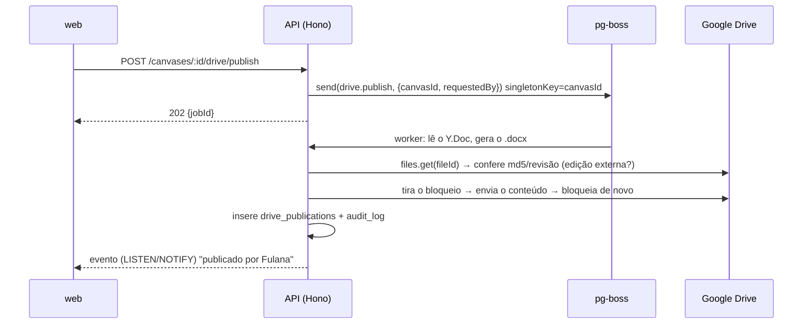

# Dicionário de dados em Word, publicado numa pasta do Drive: plano

> Plano para gerar, a partir do modelo do canvas, um documento Word com a estrutura e a formatação do modelo de referência `Modelo_Dados_CESS_Revisado.docx`, e publicá-lo numa pasta escolhida do Google Drive. A aplicação guarda o histórico de cada publicação (só metadados), protege o arquivo contra edição por fora e, quando a pasta muda, apaga o arquivo da pasta antiga. Escrito a partir do código atual (`packages/model`, `packages/crdt`, `apps/api`, `apps/web`) e do XML do documento de referência.

## Pedido (resumo)

1. Botão para **salvar um documento Word (.docx) numa pasta escolhida do Drive**.
2. O documento segue a **estrutura e a formatação** do documento de referência, com **conteúdo derivado do que está definido no canvas**.
3. **Histórico de versões só com metadados** (quem publicou, quando, qual revisão), sem guardar o conteúdo.
4. Se possível, o arquivo fica **bloqueado para edição fora da aplicação**.
5. Dá para **trocar a pasta** de destino. Ao trocar, o arquivo da pasta antiga **é apagado**, para não ficar duplicado.

## Decisões principais (TL;DR)

| Tema | Escolha | Por quê |
|---|---|---|
| Drive | **Google Drive**, atrás de uma interface `DriveProvider` | O app já tem login Google (Better Auth). Se depois quiserem OneDrive/SharePoint, entra outra implementação da mesma interface. |
| Escopo OAuth | **`drive.file`**, pedido só quando a pessoa conecta o Drive (autorização incremental) | O app só enxerga a pasta escolhida no Picker e os arquivos que ele mesmo criou. É um escopo não sensível, então não exige a auditoria de segurança (CASA) que `drive` exigiria. |
| Escolha da pasta | **Google Picker** com seleção de pasta | É o Picker que concede ao `drive.file` acesso à pasta escolhida. Também funciona com drives compartilhados. |
| Gerar o .docx | Biblioteca **`docx`** (npm), num pacote novo **`packages/docx`** com uma função pura `(Project, DocSettings, meta) → Uint8Array` | Tabelas, sombreamento, estilos, rodapé, paisagem e quebra de página são todos suportados. Como é função pura, roda na API (publicação) e no navegador (botão "Baixar .docx", inclusive no modo `/local`). |
| Onde roda a publicação | **Job pg-boss na API**, com `singletonKey = canvasId` | A fila já existe (e-mails). O job serializa as publicações de um mesmo canvas entre réplicas, tenta de novo com backoff e não segura a requisição. |
| Fonte do conteúdo | O estado atual do canvas (`deps.writer.read` + `projectDoc`), como já faz o `GET /canvases/:id/export` | É o estado mais recente, com o que ainda não foi compactado. |
| Bloqueio | **`contentRestrictions.readOnly` com `ownerRestricted: true`** + detecção de edição externa a cada publicação | É o "Bloquear arquivo" nativo do Drive: ninguém edita, e só o dono do arquivo consegue desbloquear. O dono é a conta conectada, e esse buraco é coberto pela detecção (§4). A variante "à prova de tudo" fica em §4.3. |
| Troca de pasta | **Cria o arquivo novo na pasta nova → aponta o vínculo para ele → manda o antigo para a lixeira**, com uma fila de exclusões pendentes | Nunca há um momento sem documento publicado, e uma falha na exclusão é retentada, não esquecida. |
| Histórico | Tabela **`drive_publications`** (append-only, só metadados) + `audit_log` | Mesmo padrão de `canvas_versions`, mas sem o `state`. O conteúdo de cada revisão continua no histórico de revisões do próprio Drive. |
| Granularidade | **Um documento por canvas ERD** | Um projeto pode ter vários canvases. O canvas `flow` fica de fora. |



---

## 1. O documento: estrutura e formatação

### 1.1 Especificação visual (medida no XML do documento de referência)

| Elemento | Valor |
|---|---|
| Página | A4 **paisagem** (16838 × 11906 twips). Margens: 794 em cima e embaixo, 680 nas laterais (≈1,4 cm e 1,2 cm). |
| Fonte padrão | Arial 9 pt (`sz=18`), espaçamento depois 10 pt, entrelinha 1,15. |
| Capa (sem estilo) | Linha 1: Arial 26 pt, negrito, `#0B5731`, centralizada, 50 pt de espaço antes. Linha 2: 16 pt, `#0F6F3D`, centralizada. Linha 3: 11 pt, centralizada. Depois, uma linha vazia e o parágrafo de escopo (10 pt). |
| Heading 1 | Arial 17 pt, negrito, `#0B5731`, **quebra de página antes**, 24 pt de espaço antes. Usado em "1. Convenções", "2. Índice de módulos", "Módulo X — …" e nos apêndices. |
| Heading 2 | Arial 13 pt, negrito, `#0F6F3D`. É o nome da tabela. |
| Heading 3 | Arial 11 pt, negrito, `#16834A`. Usado no título "Relacionamentos e função". |
| Parágrafo de descrição | Arial 9 pt, 4 pt de espaço depois. |
| Itens com marcador | O texto começa com "• " (o documento não usa lista numerada do Word), recuo de 227 twips, 8,5 pt, 2 pt de espaço depois. |
| Tabelas | Largura total de 15477 twips, **colunas iguais**, layout fixo, centralizadas, bordas simples pretas de 0,5 pt (`sz=4`) por dentro e por fora. Os parágrafos das células não têm espaçamento. |
| Cabeçalho das tabelas | Texto branco, negrito, 7,5 pt (`sz=15`). Fundo **`#0B5731`** nas tabelas de campos, de convenções e de módulos; fundo **`#16834A`** nas tabelas de relacionamentos. |
| Corpo das tabelas | Arial 6,5 pt (`sz=13`), preto, sem preenchimento. **Linhas de colunas do tipo enum têm fundo `#EAF4EE`** (é assim em `type`, `memberFunction`, `status` e `action`). |
| Rodapé | Centralizado, Arial 9 pt: "`<Projeto>` — `<Título>`". O de referência não tem número de página. |
| Entre blocos | Um parágrafo vazio depois de cada tabela. |

> O arquivo de referência foi gerado pelo `python-docx` e passou pelo Google Docs (tem `customXML` do Docs). O gerador reproduz os **valores** acima, não o XML byte a byte. O arquivo de referência entra no repositório como fixture (`packages/docx/tests/fixtures/referencia.docx`), para o teste de fidelidade (§9).

### 1.2 Estrutura e origem de cada parte

| Seção do documento | Origem no app |
|---|---|
| Capa: título, subtítulo, linha 3, escopo | `DocSettings.title`, `.subtitle`, `.edition` e `.scope` (§1.4). A linha 3 aceita `{projeto}`, `{versao}` e `{data}`. Padrão: "`{projeto}` — versão `{versao}`". |
| **1. Convenções de modelagem**: parágrafo + tabela Convenção/Padrão/Objetivo | `DocSettings.intro` + `DocSettings.conventions[]`. Quando a lista está vazia, o app sugere linhas detectadas no modelo: o padrão de PK mais comum (ex.: "id: BigInt autoincrement"), a presença de `uuid` único, de `created_at`/`updated_at`/`created_by`, e um enum de status comum. A pessoa revisa antes de gravar. |
| **2. Índice de módulos**: Módulo/Responsabilidade/Tabelas | `DocSettings.modules[]` (cada um é uma **tag** do canvas, com título e descrição) + tabelas com a tag. As letras A, B, C… seguem a ordem da lista. |
| **Módulo X — Título** (Heading 1) + parágrafo | `modules[i].title` e `modules[i].description`. |
| **Tabela** (Heading 2) | `Table.name`. Os pivots ocultos e as tabelas de histórico entram normalmente, a menos que `DocSettings.excludeTags` diga o contrário. |
| Parágrafo da tabela | 1ª linha de `Table.comment`. |
| Marcadores "• …" | As demais linhas de `Table.comment` (cada linha vira um marcador), mais as linhas geradas: cada **índice único parcial** ("Aplicar índice único parcial: UNIQUE(loginId) WHERE status = ACTIVE") e cada **CHECK** ("CHECK: …"). |
| Tabela de campos (9 colunas) | Uma linha por `Column`, na ordem do canvas (regras em §1.3). |
| **Relacionamentos e função** (Heading 3) + tabela de 5 colunas | Todas as relações em que a tabela aparece: FKs de saída, FKs de entrada (vistas do lado "um") e relações-nota (regras em §1.3). A seção é omitida se a tabela não tem relações. |
| "Outras tabelas" | Tabelas sem módulo entram num último módulo "Outras tabelas", ou ficam de fora com `DocSettings.unassigned = 'omit'`. |
| **Apêndice A — Resumo das restrições UNIQUE** | Por tabela: colunas `unique`, `Table.uniques` e índices únicos (os parciais com "via índice parcial"). |
| **Apêndice B — Resumo dos índices recomendados** | Por tabela: `Table.indexes` não únicos e índices implícitos de FK quando existirem. |
| Rodapé | "`{projeto}` — `{title}`". |

### 1.3 Regras de derivação das tabelas

**Tabela de campos:** `Campo | Descrição / note | Tipo | NULL? | PK | FK | Unique | Default | Índices / regras`

| Coluna | Regra |
|---|---|
| Campo | `Column.name`. |
| Descrição / note | `Column.comment`, ou "—". |
| Tipo | Nome **no estilo Prisma**, como no documento de referência: `bigint`→`BigInt`, `varchar(n)`→`VarChar(n)`, `timestamptz`→`Timestamptz`, `jsonb`→`JsonB`, `uuid`→`UUID`, `boolean`→`Boolean`, `integer`→`Int`, `date`→`Date`; enum → nome do enum; arrays → `Tipo[]`. Com `DocSettings.typeStyle = 'sql'`, sai o tipo do Postgres (`formatType`). O mapeamento fica em `packages/docx/src/types.ts` e reaproveita o que o gerador Prisma já sabe. |
| NULL? | "Sim" quando `nullable`, senão "Não". |
| PK | "Sim" se a coluna está em `primaryKey`. |
| FK | "`Tabela.coluna`" da FK em que a coluna participa (várias FKs separadas por "; "), ou "—". |
| Unique | "PK" se é a PK de uma coluna só; "Sim" se `unique` ou UNIQUE/índice único de uma coluna; "Composto" se participa de UNIQUE ou PK de várias colunas; "Parcial" se só está num índice único parcial; senão "Não". |
| Default | `identity` ou `serial` → `autoincrement`; `gen_random_uuid()` → `uuid()`; `now()`/`CURRENT_TIMESTAMP` → `now()`; literais sem as aspas SQL (`'ACTIVE'::status` → `ACTIVE`, `'{}'::jsonb` → `{}`); FK anulável sem default → `NULL`; nada → "—". |
| Índices / regras | Concatenação, separada por "; ": "PK; índice implícito." na PK; os valores do enum (`A \| B \| C`); `UNIQUE(...)`/`INDEX(...)` de cada índice que contém a coluna (os parciais com `WHERE`); `ON DELETE <AÇÃO>` da FK; "UNIQUE quando informado" em coluna única anulável. Sem nada, "—". |
| Fundo da linha | `#EAF4EE` quando o tipo é enum. |

**Tabela de relacionamentos:** `Relacionamento | Cardinalidade | FK / regra | ON DELETE | Função`

| Coluna | Regra |
|---|---|
| Relacionamento | "`A → B`", sempre a partir da tabela da seção. Com mais de uma relação para a mesma tabela, entra o rótulo entre parênteses (ex.: "Project → User (cliente)"). Relação-nota ganha "(lógico)". |
| Cardinalidade | Na notação do documento (`1 : N`, `N : 1`, `N : 0..1`, `1 : 0..1`, `1 : 1`, `N : N`). FK de saída: `N : 1`; `N : 0..1` se a FK é anulável; `1 : 1` ou `1 : 0..1` se as colunas da FK são únicas. FK de entrada: o inverso. Relação-nota: a `cardinality` gravada, convertida (`0:N` → `0..1 : N` etc.). Pivot oculto: `N : N`. |
| FK / regra | "`Filha.col → Mãe.col`". Relação-nota: o texto da diretiva `@erd:ref`. |
| ON DELETE | `onDelete` em maiúsculas (`CASCADE`, `SET NULL`, `RESTRICT`); "NO ACTION" quando ausente. Relação-nota: "Aplicação". |
| Função | `Relationship.label` (e `reverseLabel` quando a relação é vista do outro lado), ou "—". O Inspector passa a mostrar o campo **Função** também para FKs (hoje o rótulo só é editável em relação-nota). |

### 1.4 O que o modelo ainda não tem: `DocSettings`

Capa, convenções, módulos e o resto da configuração do documento precisam morar em algum lugar. A proposta é uma **raiz nova no Y.Doc**, `doc`, ao lado de `meta`, `tables` etc., validada por zod em `packages/crdt`:

```ts
interface DocSettings {
  title: string;              // "Modelo de Dados Revisado"
  subtitle: string;           // "Dicionário de Dados, Restrições, Índices e Relacionamentos"
  edition: string;            // "{projeto} — versão {versao}"
  scope: string;              // "Escopo: cadastro, autenticação, ..."
  intro: string;              // parágrafo da seção 1
  conventions: { name: string; pattern: string; goal: string }[];
  modules: { tag: string; title: string; description: string }[]; // ordem = A, B, C...
  unassigned: 'other' | 'omit';
  excludeTags: string[];      // ex.: ['history']
  typeStyle: 'prisma' | 'sql';
  fileName: string;           // "Modelo_Dados_{projeto}.docx"
}
```

Isso dá três coisas de graça: a configuração é **colaborativa** (dois editores mexendo ao mesmo tempo), entra nas **versões do canvas** (restaurar uma versão restaura também a configuração do documento) e vai junto no `.zip` do projeto (`project.json`). Os textos ficam fora de `schema`, então SQL/Prisma/Drizzle não mudam.

**Módulos = tags.** O canvas já tem tags manuais, com filtro de visualização. Um módulo é uma tag promovida, com título e descrição. Uma tabela com duas tags de módulo entra no primeiro módulo da lista, e o painel avisa ("`users` está em dois módulos; entrou no Módulo A"). Não precisa de conceito novo no canvas, e o filtro por tag continua servindo para "ver só o Módulo B".

### 1.5 O gerador (`packages/docx`)

```
packages/docx/src/
  index.ts        buildDataDictionary(project, settings, meta) → Uint8Array
  outline.ts      Project + DocSettings → árvore intermediária (seções, linhas já como texto)
  derive.ts       regras de §1.3 (tipo, unique, default, regras, cardinalidade)
  render.ts       árvore → Document do `docx` (estilos, tabelas, rodapé)
  theme.ts        as constantes de §1.1 (cores, tamanhos, margens)
```

- **Duas etapas.** `outline` produz uma estrutura simples (`{ kind: 'table', header, rows, fill }`...), que é o que os testes de regra comparam. `render` só formata. Assim dá para testar a derivação sem abrir o XML.
- **Determinístico.** Com a mesma entrada, o resultado é o mesmo, porque as datas de `docProps/core.xml` vêm de `meta.publishedAt`. Isso permite o atalho de "nada mudou" (§3).
- `meta = { version: number, publishedAt: Date, projectName: string }` preenche `{versao}`, `{data}` e o rodapé.
- No navegador, o pacote roda num Web Worker (o mesmo padrão do `parser.worker`), para não travar a interface em canvases de 200 tabelas.

---

## 2. Conexão com o Google Drive

### 2.1 Quem conecta e com que credencial

- O **dono do projeto** conecta o Drive ("Conectar Google Drive" em **Configurações do projeto → Documento**). A conta Google dele vira a **conta conectada** do vínculo, e **todas as publicações usam o token dela**, não importa quem apertou o botão.
- Por quê: com `drive.file`, o acesso vale para os arquivos que o app criou **com aquela conta** e para a pasta escolhida no Picker **por aquela conta**. Usar sempre a mesma conta garante que o app consiga atualizar, bloquear e apagar o arquivo. O histórico registra **quem pediu** cada publicação (o usuário do app), que é o que interessa.
- **Better Auth.** `authClient.linkSocial({ provider: 'google', scopes: ['https://www.googleapis.com/auth/drive.file'], callbackURL })` pede o escopo a mais. Funciona tanto para quem entrou com e-mail e senha quanto para quem já entrou com Google. No servidor, `auth.api.getAccessToken({ body: { providerId: 'google', userId } })` entrega um token válido e renova sozinho.
- Ajustes no `createAuth`:
  - `google: { ..., accessType: 'offline', prompt: 'consent' }`, para receber o *refresh token*.
  - `account.encryptOAuthTokens: true`, para cifrar os tokens em `accounts`. Os tokens atuais, em texto puro, são migrados por um script único.
  - `accountLinking.allowDifferentEmails: true`, porque a conta do Drive (institucional, por exemplo) pode ter outro e-mail.
- Variáveis novas no `env.ts`: `GOOGLE_PICKER_API_KEY` (restrita por *referrer* ao `APP_URL`) e `GOOGLE_PROJECT_NUMBER` (o `appId` do Picker). A funcionalidade só aparece com `GOOGLE_CLIENT_ID` + essas duas. O `web` continua sem variáveis de build: lê tudo de `GET /api/drive/config`.
- **Console do Google Cloud:** ativar a Drive API e a Picker API e adicionar o escopo `drive.file` na tela de consentimento. É escopo não sensível, mas confirme a classificação no console ao configurar.

### 2.2 Escolha da pasta

1. O web pede `GET /api/projects/:id/drive/picker-token`. Só a conta conectada recebe resposta, com um *access token* curto.
2. Abre o **Google Picker**: `DocsView(ViewId.FOLDERS)`, `setSelectFolderEnabled(true)`, `setIncludeFolders(true)`, `setEnableDrives(true)` (drives compartilhados) e `setAppId(GOOGLE_PROJECT_NUMBER)`. O `setAppId` é obrigatório: é ele que dá ao `drive.file` acesso à pasta escolhida.
3. O web manda `{ folderId }` para a API. A API confere com `files.get(folderId, fields: 'id,name,mimeType,driveId,capabilities(canAddChildren)')`: precisa ser pasta e a conta conectada precisa poder criar arquivos nela. Também guarda o nome e o caminho para mostrar na interface.

### 2.3 Permissões (`packages/contracts/src/permissions.ts`)

Duas ações novas na regra única:

| Ação | owner | editor | viewer |
|---|:-:|:-:|:-:|
| `driveConfigure`: conectar, escolher/trocar pasta, desconectar, editar `DocSettings` | ✔ | ✘ | ✘ |
| `drivePublish`: "Salvar no Drive" | ✔ | ✔ | ✘ |
| Ver status e histórico de publicações, baixar o .docx localmente | ✔ | ✔ | ✔ |

> Editar `DocSettings` é editar o Y.Doc, então o collab precisa recusar escrita na raiz `doc` de quem não tem `driveConfigure`. Isso vai na mesma checagem que hoje recusa updates de leitores. Se for simples demais restringir por raiz, a alternativa é deixar editores mexerem no texto do documento (é conteúdo, como as notas) e limitar ao dono só a conexão e a pasta. Ver §12.

---

## 3. Publicar ("Salvar no Drive")

`POST /api/canvases/:id/drive/publish` → `requireCan('drivePublish')` → enfileira `drive.publish` com `singletonKey = canvasId` e responde `202 { jobId }`. Se já houver uma publicação na fila para o canvas, o pg-boss junta as duas, e a pessoa vê "publicação em andamento".

O worker, dentro do job:

1. **Lê o estado** (`deps.writer.read`) e projeta `Project` + `DocSettings`. Calcula `contentHash = sha256(json canônico de { schema, meta, notes, docSettings, nome do projeto })`. Se for igual ao da última publicação bem-sucedida e o pedido não tiver `force`, registra "sem mudanças" e termina.
2. **Pega o token** da conta conectada. Se falhar (`invalid_grant`, conta desvinculada), o vínculo vai para `needs_reconnect`, o dono é avisado no sininho e o job termina sem retentar.
3. **Confere o arquivo atual** (se já existe): `files.get(fileId, fields: 'id,trashed,parents,md5Checksum,headRevisionId,modifiedTime,lastModifyingUser(displayName,emailAddress),contentRestrictions')`.
   - 404 ou `trashed` → o arquivo some do vínculo e este passo cria um novo. O histórico registra `recreated`.
   - `md5Checksum`/`headRevisionId` diferente do último registrado → **edição externa**. Registra `external_edit_detected` com `lastModifyingUser` e `modifiedTime`, avisa o dono e segue: o app é a fonte da verdade e sobrescreve.
   - `parents` sem a pasta configurada → alguém moveu o arquivo. Registra `moved_externally` e devolve o arquivo à pasta (`addParents`/`removeParents`).
4. **Gera o .docx** com `version = última + 1`.
5. **Grava no Drive:**
   - Arquivo novo: `files.create` (multipart) com `name`, `parents: [folderId]`, `mimeType` do .docx (**sem converter** para Google Docs, para preservar a formatação), `appProperties: { erdCanvasId, erdProjectId }`, `description: "Gerado pelo ERD Builder. Edições feitas fora do app serão sobrescritas."`, `writersCanShare: false`.
   - Arquivo existente: `files.update` com `contentRestrictions: [{ readOnly: false }]` → `files.update` com mídia (e `name`, se `fileName` mudou) → bloqueio de novo (§4). O desbloqueio fica no mesmo job, e o passo de bloquear roda num `finally`. Se até isso falhar, o vínculo fica `lock_pending` e um job de reparo (§4.2) tenta de novo.
6. **Registra** (numa transação): linha em `drive_publications` (`status='ok'`, `driveRevisionId`, `md5`, tamanho, `version`, `contentHash`, `requestedBy`), atualização de `drive_bindings` (último md5/revisão/hash) e `audit_log` (`drive.published`).
7. **Avisa** quem está no canvas por `deps.events.broadcast(canvasId, { type: 'drivePublished', by, version, url })` (o mesmo canal do "versão restaurada"). O toast mostra "Fulana publicou a versão 7 no Drive" com link para o arquivo.

**Erros:** 429 e 5xx do Google → retentativa do pg-boss (backoff exponencial, até 5 vezes). 403 de permissão na pasta → `needs_folder` e aviso ao dono. Toda falha final também vira uma linha em `drive_publications` (`status='failed'`, `error`), para o histórico mostrar a tentativa.

**Publicação automática (opcional, fase 4):** um toggle "Publicar ao salvar uma versão nomeada" enfileira o mesmo job no `POST /versions`. Publicar a cada edição gera revisões demais no Drive e não vale a pena.

---

## 4. Bloqueio contra edição fora da aplicação

### 4.1 Mecanismo principal: "Bloquear arquivo" do Drive

```http
PATCH /drive/v3/files/{fileId}?supportsAllDrives=true
{ "contentRestrictions": [{ "readOnly": true, "ownerRestricted": true,
    "reason": "Gerado pelo ERD Builder. Edite pelo app e publique de novo." }] }
```

- Com `readOnly`, **ninguém** consegue criar revisão, comentar ou renomear o arquivo, nem quem tem permissão de editor na pasta. O Word Online e o modo Office do Docs abrem em leitura, e o Drive para desktop não consegue enviar alterações.
- Com `ownerRestricted`, só o **dono do arquivo** (em drive compartilhado, um *organizer*) consegue tirar o bloqueio. O dono é a conta conectada, e o app tira e põe o bloqueio só durante a gravação (§3, passo 5).
- Confira `capabilities.canModifyOwnerContentRestriction` depois de criar o arquivo. Se vier `false` (política do Workspace, por exemplo), cai para `readOnly` sem `ownerRestricted` e a interface avisa que o bloqueio é "fraco".

**O que esse mecanismo não impede:** a própria conta conectada pode desbloquear o arquivo pela interface do Drive; qualquer pessoa com acesso de leitura pode baixar e fazer uma cópia (é inerente a quem pode ler); e quem é dono da pasta pode mover o arquivo. Os dois primeiros casos são cobertos pela detecção abaixo, e o terceiro pelo passo 3 de §3.

### 4.2 Detecção e reparo

- **A cada publicação**, o passo 3 de §3 compara `md5Checksum` e `headRevisionId` e registra quem editou por fora.
- **Job periódico** `drive.audit` (pg-boss `schedule`, a cada 6 h; só vínculos ativos): `files.get` com `contentRestrictions`, `md5Checksum` e `trashed`. Se o arquivo foi desbloqueado, bloqueia de novo e registra `relocked`. Se o conteúdo mudou, registra `external_edit_detected` e avisa o dono ("O documento foi editado no Drive por Fulano. A próxima publicação vai sobrescrever. [Publicar agora]"). Ele **não** republica sozinho, para a pessoa poder ver o que mudou antes (a revisão externa continua no histórico de revisões do Drive).
- Custo: uma chamada por vínculo a cada 6 h, desprezível perto da cota da Drive API.

### 4.3 Variante "à prova de tudo" (se o bloqueio acima não bastar)

Para que **nenhuma pessoa** consiga desbloquear o arquivo, ele não pode pertencer a uma pessoa:

- Uma **conta de serviço** do app é membro **Gerente de conteúdo** de um **drive compartilhado**, e a pasta de destino fica dentro dele.
- Os usuários entram no drive compartilhado como **Leitor/Comentarista**, e o app cria, bloqueia e apaga o arquivo com a credencial da conta de serviço. Contas de serviço não têm cota no "Meu Drive", então isso só funciona com drive compartilhado.
- Custo: exige Google Workspace, um drive compartilhado configurado pelo admin e outra forma de escolher a pasta (sem o Picker do usuário, uma lista das pastas do drive compartilhado vinda da API).
- A interface `DriveProvider` deixa isso entrar depois como `ServiceAccountDriveProvider`, sem mudar o fluxo de §3 e §5. **Recomendação:** começar com §4.1 + §4.2 e só partir para isso se aparecer edição externa de verdade.

---

## 5. Trocar a pasta

`PUT /api/projects/:id/drive/binding/:canvasId/folder { folderId }` → `requireCan('driveConfigure')` → job `drive.relocate` (mesmo `singletonKey` do publish, então nunca roda junto com uma publicação do mesmo canvas).

1. Valida a pasta nova (§2.2, passo 3). Se for a mesma pasta, não faz nada.
2. **Cria o arquivo na pasta nova**, gerado do estado atual e já bloqueado (§3, passos 4 e 5), com `version = última + 1`. Se falhar, nada muda: o vínculo continua na pasta antiga e o erro aparece na tela.
3. **Numa transação:** o vínculo passa a apontar para a pasta e o arquivo novos; entra uma linha `folder_changed` em `drive_publications` (pasta antiga → nova, arquivo antigo → novo, quem pediu); e o arquivo antigo vai para **`drive_pending_deletions`** (`fileId`, `connectedUserId`, tentativas, último erro).
4. **Apaga o antigo:** tira o bloqueio e manda para a lixeira (`files.update { trashed: true }`). Se der certo, remove a linha pendente e preenche `oldFileRemovedAt` na linha do histórico. Se der 404, já não existe, então conta como sucesso.
5. **Se a exclusão falhar**, o job `drive.cleanup` tenta de novo com backoff (até 24 h). Enquanto isso, a interface mostra "O arquivo antigo em *Pasta X* ainda não foi removido" com link. Depois do limite, o aviso vira "remova manualmente".

A ordem (criar → apontar → apagar) garante que **sempre existe um documento publicado** e que o app **nunca considera dois arquivos ativos**. Um arquivo antigo que sobrar fica registrado em `drive_pending_deletions` e na tela, não esquecido.

**Lixeira em vez de exclusão permanente:** o arquivo sai da pasta na hora, então não há duplicação, e ainda pode ser recuperado por 30 dias se a troca foi um engano. Se preferirem exclusão definitiva, é trocar `trashed: true` por `files.delete` (ver §12).

**Casos de borda:**
- **Trocar a conta conectada** (o dono reconecta com outra conta Google): a conta nova não tem acesso ao arquivo antigo, então a troca vira uma troca de pasta (o Picker abre com a conta nova). A exclusão do antigo usa o token da conta **antiga**, guardado em `drive_pending_deletions.connectedUserId`. Se essa conta não estiver mais disponível, a interface pede a remoção manual, com link.
- **Desconectar:** pergunta se quer apagar o arquivo do Drive ou deixá-lo lá desbloqueado (padrão: deixar, porque o arquivo é da pessoa). O histórico continua.
- **Canvas ou projeto excluído** (soft delete): o vínculo é pausado. O arquivo só é apagado no expurgo definitivo do projeto, se esse expurgo existir.

---

## 6. Histórico de versões (só metadados)

Duas tabelas novas em `packages/db/src/schema/app.ts` (migração gerada com `pnpm db:generate`) e uma de apoio:

```ts
/** Um vínculo por canvas: onde o documento está publicado e com que conta */
export const driveBindings = pgTable('drive_bindings', {
  canvasId: text('canvas_id').primaryKey().references(() => canvases.id, { onDelete: 'cascade' }),
  projectId: text('project_id').notNull().references(() => projects.id, { onDelete: 'cascade' }),
  provider: text('provider').notNull().default('google'),
  connectedUserId: text('connected_user_id').references(() => users.id),
  folderId: text('folder_id').notNull(),
  folderName: text('folder_name').notNull(),
  folderPath: text('folder_path'),
  driveId: text('drive_id'),                       // drive compartilhado, se houver
  fileId: text('file_id'),
  fileName: text('file_name'),
  webViewLink: text('web_view_link'),
  lastRevisionId: text('last_revision_id'),
  lastMd5: text('last_md5'),
  lastContentHash: text('last_content_hash'),
  lastVersion: integer('last_version').notNull().default(0),
  lock: text('lock').notNull().default('none'),     // none | strong | weak | pending
  status: text('status').notNull().default('active'), // active | needs_reconnect | needs_folder | paused
  createdAt: created(),
  updatedAt: ts('updated_at').notNull().defaultNow(),
});

/** Append-only: cada publicação, troca de pasta ou evento observado no Drive */
export const drivePublications = pgTable('drive_publications', {
  id: text('id').primaryKey(),
  canvasId: text('canvas_id').notNull().references(() => canvases.id, { onDelete: 'cascade' }),
  action: text('action').notNull(),  // published | unchanged | failed | folder_changed | recreated
                                     // | external_edit_detected | moved_externally | relocked | disconnected
  version: integer('version'),       // número da versão do documento (capa: "versão N")
  requestedBy: text('requested_by').references(() => users.id), // quem pediu no app (null = job automático)
  fileId: text('file_id'),
  driveRevisionId: text('drive_revision_id'),
  md5: text('md5'),
  sizeBytes: integer('size_bytes'),
  contentHash: text('content_hash'),
  folderId: text('folder_id'),
  folderName: text('folder_name'),
  previousFolderId: text('previous_folder_id'),   // só em folder_changed
  previousFolderName: text('previous_folder_name'),
  previousFileId: text('previous_file_id'),
  oldFileRemovedAt: ts('old_file_removed_at'),
  externalActor: jsonb('external_actor').$type<{ name?: string; email?: string }>(), // lastModifyingUser do Drive
  canvasVersionId: text('canvas_version_id').references(() => canvasVersions.id, { onDelete: 'set null' }),
  error: text('error'),
  createdAt: created(),
}, (t) => [index('drive_publications_canvas_idx').on(t.canvasId, t.createdAt)]);

export const drivePendingDeletions = pgTable('drive_pending_deletions', {
  fileId: text('file_id').primaryKey(),
  canvasId: text('canvas_id').notNull(),
  connectedUserId: text('connected_user_id').references(() => users.id),
  attempts: integer('attempts').notNull().default(0),
  lastError: text('last_error'),
  createdAt: created(),
});
```

- **Sem conteúdo:** não há `bytea` nem bucket. Para ver o conteúdo de uma versão antiga existem dois caminhos: (a) a revisão no Drive, usando `driveRevisionId` (o Drive guarda revisões de arquivos binários por 30 dias ou 100 revisões, a menos que sejam marcadas `keepForever`; ver §12); (b) **regenerar** a partir da versão do canvas, quando `canvasVersionId` está preenchido. Como o gerador é determinístico, a regeneração bate com o original enquanto o gerador não mudar.
- `DocSettings` fica no Y.Doc, então uma versão do canvas guarda também a configuração do documento daquele momento.
- **Retenção:** o histórico é pequeno (centenas de bytes por linha) e fica para sempre. Se precisar, entra um limite por canvas como `MAX_VERSIONS_PER_CANVAS`.

---

## 7. API (`apps/api/src/routes/drive.ts`)

| Rota | Permissão | O quê |
|---|---|---|
| `GET /api/drive/config` | logado | `{ enabled, pickerApiKey, appId, clientId }` |
| `GET /api/projects/:id/drive` | `view` | Conta conectada (nome/e-mail do Google), se a pessoa atual é a conectada, e os vínculos por canvas com status. |
| `POST /api/projects/:id/drive/connect` | `driveConfigure` | Marca a pessoa atual como conectada (depois do `linkSocial`). Confere o escopo `drive.file` em `accounts.scope`. |
| `GET /api/projects/:id/drive/picker-token` | conta conectada | Access token curto para o Picker. |
| `PUT /api/canvases/:id/drive/folder` | `driveConfigure` | Primeira escolha de pasta (cria o vínculo e enfileira a primeira publicação) ou troca de pasta (§5). |
| `POST /api/canvases/:id/drive/publish` | `drivePublish` | Enfileira a publicação (§3). `{ force?: boolean }`. |
| `GET /api/canvases/:id/drive/publications` | `view` | Histórico paginado (com nomes de `requestedBy`). |
| `GET /api/canvases/:id/drive/jobs/:jobId` | `view` | Estado do job (para o botão mostrar "publicando…"). O evento por WebSocket também chega. |
| `GET /api/canvases/:id/docx` | `export` | Gera e baixa o .docx na hora, sem Drive. |
| `DELETE /api/projects/:id/drive` | `driveConfigure` | Desconecta (§5, "Desconectar"). |

- `packages/contracts/src/dto.ts`: `DriveBindingZ`, `DrivePublicationZ`, `DocSettingsZ`, `PublishZ`.
- `apps/api/src/drive/`:
  - `provider.ts`: interface `DriveProvider { getFolder, createFile, updateContent, setLock, getFileState, move, trash }`.
  - `google.ts`: implementação com `fetch` na Drive API v3. Não precisa do `googleapis` inteiro (pesado), só multipart upload e `supportsAllDrives=true` em todas as chamadas.
  - `jobs.ts`: workers `drive.publish`, `drive.relocate`, `drive.cleanup` e `drive.audit` na mesma instância pg-boss do `mailQueue` (extrair um `queue.ts` compartilhado).
- Métricas em `/metrics`: `drive_publish_total{status}`, `drive_publish_seconds`, `drive_external_edits_total`, `drive_pending_deletions`.
- Logs com `canvasId`, `fileId` e `jobId`. Nunca logar tokens.

## 8. Front-end (`apps/web`)

- **Botão "Salvar no Drive"** no `Header` do editor, ao lado do histórico, só quando há vínculo. Estados: "Salvar no Drive", "Publicando…" e "Publicado · v7 · há 2 min" (com link para o arquivo). Se o conteúdo mudou desde a última publicação, aparece um ponto de alerta no botão (compara o `contentHash` local com o do vínculo, calculado no worker).
- **Diálogo "Documento Word"** (aba nova em Configurações do projeto e atalho no menu do canvas):
  - **Conexão:** "Conectar Google Drive", conta conectada, "Reconectar", "Desconectar".
  - **Pasta:** caminho atual com link e "Trocar pasta…" (abre o Picker). Antes de trocar, confirma: "O documento será criado em *Nova* e o arquivo em *Antiga* irá para a lixeira do Drive."
  - **Conteúdo:** título, subtítulo, linha de edição, escopo, introdução, tabela de convenções (editável, com "Sugerir a partir do modelo") e **módulos** (lista ordenável: tag → título → descrição, com a contagem de tabelas e um aviso para tabelas sem módulo ou em dois módulos). Também tipos (Prisma/SQL), tags excluídas e nome do arquivo.
  - **Pré-visualização:** "Baixar .docx" (gerado no navegador, no worker).
- **Histórico de publicações:** aba no `VersionsDialog` ("Versões do canvas" | "Publicações no Drive"). Cada linha mostra a versão, quem publicou, quando, a pasta e um ícone por tipo de evento (publicado, pasta trocada, edição externa por *Fulano no Drive*, recriado, falhou com motivo). Com `canvasVersionId`, aparece "Ver versão do canvas".
- **Inspector:** campo **Função** nas FKs (vai para `Relationship.label`) e um aviso discreto quando uma coluna não tem descrição ("aparecerá como — no documento").
- **Modo `/local`:** só "Baixar .docx" (sem Drive), com `DocSettings` guardado no projeto local.

## 9. Testes

| Nível | O quê |
|---|---|
| Unitário (`packages/docx`) | Regras de §1.3 em `outline`: tipo, unique (PK/Sim/Composto/Parcial), default, regras, cardinalidade nos dois sentidos, relação-nota, pivot, tabelas sem módulo, tabela em dois módulos. Propriedade (fast-check): todo `Table` e toda `Column` do modelo aparecem exatamente uma vez. |
| **Fidelidade ao modelo de referência** | Uma fixture `cess.sql` reconstrói o modelo do documento (User, Login, AuthSession... com os comentários). O teste gera o .docx, abre o XML (`jszip`) e compara com a referência: textos de cabeçalhos e títulos, quantidade de tabelas e linhas, conteúdo das células (normalizado), cores de preenchimento por tipo de tabela, tamanhos de fonte, página/margens, `pageBreakBefore` do Heading 1 e rodapé. Diferenças esperadas ficam numa lista explícita. |
| Visual (CI, opcional) | `soffice --headless --convert-to pdf` do gerado e da referência, renderizados em PNG (página 1, 3 e a do Módulo B), com comparação por limiar. Pega regressão de layout que o XML não mostra. |
| Integração (API) | `DriveProvider` falso em memória que imita a Drive API, inclusive `contentRestrictions` (recusar update de conteúdo com `readOnly`), md5, revisões, lixeira, 404 e 429. Casos: primeira publicação, "sem mudanças", edição externa detectada, arquivo apagado por fora → recriado, troca de pasta com falha no create (nada muda), troca com falha no trash (fica pendente e o `cleanup` resolve), duas publicações concorrentes (o `singletonKey` serializa), token revogado → `needs_reconnect`, permissões por papel. |
| Contrato (manual/staging) | Script `pnpm drive:smoke` contra uma conta Google de teste: cria pasta, publica, tenta editar com outra conta (espera 403), troca pasta, confere a lixeira. Não roda no CI (precisa de credencial real). |
| E2E (Playwright) | Com o provider falso injetado por `DRIVE_PROVIDER=fake`: configurar módulos, publicar, ver o toast em outro navegador, trocar pasta, ver o histórico. O Picker é substituído por um seletor simples no modo fake. |

## 10. Fases de entrega

Cada fase pode ir para produção sozinha.

| Fase | Entrega | Pronto quando |
|---|---|---|
| **1. Gerador + download** | `packages/docx`, raiz `doc` no Y.Doc com `DocSettings`, diálogo de conteúdo (módulos, convenções), campo Função nas FKs, "Baixar .docx" (web, `/local` e `GET /canvases/:id/docx`). | O teste de fidelidade passa e o .docx da fixture CESS abre no Word e no Google Docs igual à referência. **Aqui dá para validar o formato com quem usa antes de mexer no Drive.** |
| **2. Conexão + pasta + publicação** | `linkSocial` com `drive.file`, tokens cifrados, Picker, `drive_bindings`, `drive_publications`, job `drive.publish`, botão e toast, histórico. | Publicar cria e atualiza o arquivo na pasta, e o histórico mostra quem e quando. |
| **3. Bloqueio + troca de pasta** | `contentRestrictions` com `ownerRestricted`, detecção de edição externa, `drive.relocate`, `drive_pending_deletions`, `drive.cleanup`, `drive.audit`. | Outra conta não consegue editar; trocar de pasta deixa um só arquivo; uma falha na exclusão aparece e se resolve sozinha. |
| **4. Acabamento** | Publicar ao salvar uma versão nomeada, métricas, `pnpm drive:smoke`, docs no README (configuração no Google Cloud) e, se precisar, a variante de §4.3. | — |

## 11. Riscos e mitigação

| Risco | Mitigação |
|---|---|
| O dono desbloqueia o arquivo e edita no Drive | `ownerRestricted` limita o desbloqueio ao dono; `drive.audit` re-bloqueia e avisa; a próxima publicação sobrescreve; a revisão externa fica no Drive. Para bloqueio total, §4.3. |
| Token expira ou é revogado (troca de senha, revogação nas permissões da conta Google) | `getAccessToken` renova; com `invalid_grant`, o status vira `needs_reconnect` e o dono recebe sininho e e-mail. As publicações pedidas nesse meio tempo falham com uma mensagem clara. |
| Dono sai do projeto ou exclui a conta | O vínculo vai para `needs_reconnect`, e o novo dono reconecta, o que vira uma troca de pasta (§5, casos de borda). |
| Falha entre desbloquear e bloquear de novo | Bloqueio no `finally`, `lock='pending'` e reparo pelo `drive.audit`. A janela é de poucos segundos. |
| Documento grande (200+ tabelas) | O `docx` gera centenas de páginas em menos de um segundo no Node. Upload multipart até 5 MB; acima disso, upload *resumable*. Métrica `drive_publish_seconds`. |
| Fidelidade visual diferente entre Word, LibreOffice e Google Docs | Usar só recursos que o documento de referência já usa (sem campos, sem listas numeradas, sem estilos de tabela complexos) e o teste visual da fase 1. |
| Política do Google Workspace bloqueia apps de terceiros ou o `drive.file` | Mensagem clara no "Conectar" e documentação para o admin liberar o app (ID do cliente OAuth). |
| Revisões antigas somem do Drive (30 dias ou 100 revisões) | O histórico de metadados continua, e o conteúdo pode ser regenerado da versão do canvas (§6). Se precisarem do binário original de cada versão, marcar `keepForever` nas revisões publicadas (limite de 200 por arquivo). |

## 12. Decisões em aberto (com recomendação)

1. **Qual Drive?** O plano assume **Google Drive**, porque o app já tem login Google. Se for OneDrive/SharePoint, o fluxo continua o mesmo com Microsoft Graph, mas o bloqueio muda (SharePoint não tem um "bloquear arquivo" equivalente; o caminho seria permissões só de leitura na pasta ou rótulo de retenção).
2. **Lixeira ou exclusão definitiva ao trocar de pasta?** Recomendo **lixeira**: o arquivo sai da pasta (não há duplicação) e dá para recuperar por 30 dias.
3. **Quem configura?** Recomendo só o **dono** para conexão e pasta. Para o texto do documento (capa, convenções, módulos), recomendo liberar para **editores**: é conteúdo como as notas, e evita restringir escrita por raiz no collab.
4. **Bloqueio forte (§4.3) já na primeira entrega?** Recomendo **não**: começar com o "Bloquear arquivo" + detecção e só migrar para conta de serviço + drive compartilhado se aparecer edição externa real.
5. **Mover em vez de recriar ao trocar de pasta?** O Drive permite mover o arquivo (`addParents`/`removeParents`), o que mantém o mesmo ID e as revisões. O plano segue o que foi pedido (criar na nova e apagar na antiga), porque isso também funciona entre contas e drives diferentes. Se preferirem, dá para tentar mover primeiro e só recriar quando mover falhar.
