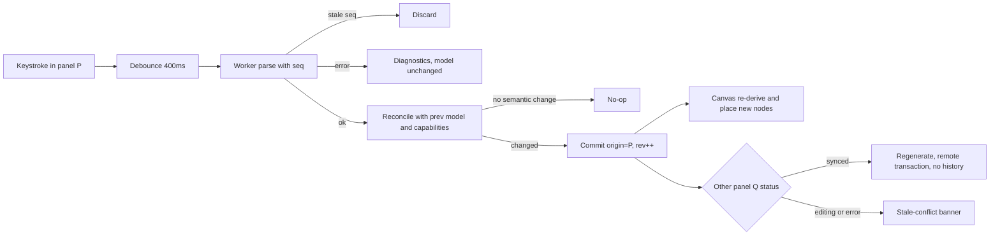

# ERD Builder — plano de arquitetura e contexto da sessão

> Documento gerado para permitir continuar este planejamento/implementação em outra sessão (ex.: Claude Code na nuvem). Contém o pedido original, as decisões já tomadas e o plano de arquitetura completo, incluindo a revisão técnica detalhada de um agente de planejamento.

## Estado do projeto

- Diretório `C:\Users\loren\Projetos\ERD-to-schema` estava vazio no início (sem git, sem código).
- Ambiente local onde o plano foi feito: Windows 11, Node v22.23.1, npm 10.9.8, sem pnpm.
- Nada foi implementado ainda — este documento é o resultado da fase de planejamento, antes de qualquer código ser escrito.
- **Se for continuar na nuvem**: será necessário inicializar um repositório git (`git init`) neste diretório, pois sessões de nuvem normalmente exigem um repo git para operar.

## Pedido original do usuário (verbatim)

> Quero que você desenvolva uma aplicação web que renderiza um canva interativo de construção de ERD (Entity-relation-Diagram). Quero que esse canva gere automaticamente o schema da aplicação, mas que também escrever o schema atualize a interface gráfica do canvas automaticamente, fazendo os redimensionamentos e atualizações na UI necessários. Esse schema deve ser capaz de ser escrito em SQL puro (suportanto inicialmente o postgres), assim como drizzle-kit (em typescript) e prisma. Alterar a versão do schema em prisma atualiza a do drizzle e do sql, todos se atualizam, assim como a versão gráfica do canva. Quero que o canvas tenha atalhos de teclado parecidos com excalidraw e o eraser, como ctrl + seta para criar nova tabela com relação. Quero que as relações de FK sejam renderizadas de maneiras distintas, e que relações somente de nota também. Quero multiplas opções de visualização do canvas para filtrar da visualização as relações de notas, tabelas pivot (geradas automaticamente por relações N:N), tabelas de histórico, etc... Quero também um bloco de texto no canvas que sirva de nota, cada bloco vira um arquivo md que dá pra ser exportado. Quero também que haja a possibilidade de exportar a seleção do canvas como png e pdf.

Interpretação chave: embora o usuário tenha citado "Prisma atualiza Drizzle e SQL" como exemplo, o requisito real é **sincronização bidirecional completa**: canvas, SQL, Prisma e Drizzle são quatro vistas de um único modelo — editar qualquer uma propaga para as outras três, não apenas na direção Prisma→demais.

## Decisão do usuário sobre sequenciamento

Perguntado como sequenciar um projeto deste tamanho, o usuário escolheu:

**"MVP sólido primeiro"** — entregar primeiro canvas + sync bidirecional robusto com SQL puro (a base mais arriscada tecnicamente), depois Prisma, depois Drizzle, e só então atalhos/filtros/notas/export em fases seguintes. Cada fase deve ser testável e usável antes de avançar para a próxima.

## Plano de arquitetura final

(Conteúdo idêntico ao plano salvo em `C:\Users\loren\.claude\plans\replicated-strolling-babbage.md` nesta sessão.)

### Stack

- **Build**: Vite + React 19 + TypeScript, npm.
- **Canvas**: `@xyflow/react` (React Flow 12) — nodes customizados (tabela, nota), edges customizados (FK vs nota), handles por coluna.
- **Estado**: `zustand` + `immer` + `zundo` (undo/redo).
- **Persistência**: IndexedDB via `idb-keyval` (não localStorage — limite de 5MB e writes síncronos). Projeto exportável como `.zip` (via `fflate`): `project.json` (modelo+layout) + `notes/*.md` + cópias de `schema.sql`/`schema.prisma`/`schema.ts`.
- **Salvar arquivo**: File System Access API quando disponível (Chromium), fallback para Blob + `<a download>`.
- **Editores de código**: CodeMirror 6 (`@uiw/react-codemirror`) com `@codemirror/lang-sql`, `@codemirror/lang-javascript`, `@codemirror/lang-markdown`, `@codemirror/lint` — mais leve que Monaco para 3-4 painéis pequenos.
- **Styling**: Tailwind CSS 4.
- **Workers**: `comlink`, para isolar parsers (SQL/Prisma/Drizzle) do main thread.

### Modelo canônico (fonte única de verdade)

Separar **significado** de **apresentação**, em seções distintas de um mesmo `Project`:

```ts
Project {
  schema: SchemaModel   // tables, columns, enums, relationships — o que os 3 formatos de texto expressam
  layout: Record<EntityId, {x, y, w?, h?, collapsed?}>   // só canvas, nunca escrito nos textos
  meta:   Record<EntityId, {tags: Set<string>, provenance?, formatNames?}>
  notes:  NoteBlock[]    // canvas + .md, nunca em SQL/Prisma/Drizzle
  view:   {filters, activeTool, ...}
}
```

- Altura da tabela é derivada da contagem de colunas (React Flow mede nodes); largura só é guardada se o usuário redimensionar manualmente.
- `Relationship` tem `kind: 'fk' | 'note'`, cardinalidade, colunas de origem/destino, ações `onDelete`/`onUpdate`.
- `Table.meta.tags` guarda tags automáticas (`pivot`, `history`, `enum`) e manuais, com `provenance` (ex.: qual relação N:N gerou aquela tabela pivot) para filtros e regeneração segura.

#### Reconciliação (o coração do sistema)

Os formatos de texto identificam coisas por nome; o modelo identifica por ID estável. Cada parse gera um modelo com IDs novos — `reconcile(prev, parsed, capabilities)` precisa:
1. Casar tabelas por `(schema, dbName)`; detectar rename por sobra 1-para-1 + ≥60% de overlap de nomes de coluna.
2. Casar colunas por nome dentro da tabela; rename por sobra 1-para-1 com mesmo tipo/posição.
3. Casar relações por `(fromTable, fromCols, toTable, toCols)`, não por nome de constraint.
4. **Capability matrix por formato** (o que cada formato consegue expressar — ex.: Prisma não tem CHECK constraint, Drizzle perde comentários JS): qualquer campo fora da capability do formato que gerou o parse é copiado do modelo anterior, não é descartado. Isso evita que editar um nome no Prisma apague CHECKs silenciosamente.
5. Conceitos canvas-only (relação-nota, tags) sobrevivem em SQL/Prisma via comentários-diretiva (`-- @erd:ref ...`, `/// @erd:ref ...`).

### Estratégia por formato

- **SQL (Postgres)**: `libpg-query` (parser real do Postgres compilado para WASM, roda num Web Worker) — não hand-rolled, não `node-sql-parser` (cobertura de DDL fraca). Fallback: `pgsql-ast-parser`. Validar no spike que a versão instalada traz WASM prebuilt (sem precisar node-gyp no Windows/Linux).
- **Prisma**: `@mrleebo/prisma-ast` (puro TS/Chevrotain, roda no browser, preserva comentários). `@prisma/internals` fica fora (precisa do engine Rust). Validação semântica própria (relations nos dois lados, `@relation` aponta para campos existentes). M:N implícito do Prisma gera tabela pivot real com provenance; ao gerar, preferir explícito exceto quando o pivot original era implícito e segue só com colunas `A`/`B`.
- **Drizzle (TS)**: em vez de fazer parsing estático de TS (frágil contra helpers/loops/spread), **transpilar com `sucrase`** (mantém números de linha) e **executar o código num Web Worker sandboxado** contra o `drizzle-orm/pg-core` real, com `require` restrito a `drizzle-orm`. Ler a estrutura de volta via `getTableConfig`/`getTableColumns` da própria lib. Timeout (~1.5s) com `worker.terminate()` em caso de loop infinito. Pinar uma versão exata de `drizzle-orm`.

### Motor de sincronização (evita loops e corrupção)

Cada painel de texto tem `status: 'synced' | 'editing' | 'error' | 'stale-conflict'` e `baseRev`. Fluxo por keystroke:
1. Debounce 400ms (ou blur/Ctrl+S) → manda `{format, text}` pro worker com um `seq` crescente.
2. Resultado com `seq` desatualizado é descartado.
3. Erro de parse → mostra diagnóstico (CodeMirror lint), **modelo não muda**, outros painéis não são tocados.
4. Sucesso → `reconcile` → se não houve mudança semântica, no-op; senão `commit(next, {origin: P})` (bump de `rev`, 1 entrada de undo).
5. Todo commit notifica: canvas re-deriva nodes/edges (só posiciona entidades novas); cada painel `Q ≠ origin` com `status==='synced'` é regenerado via transação CodeMirror marcada `remote` (não dispara novo parse — isso é o que evita o loop de feedback); painel com edição pendente ou erro recebe um banner de conflito em vez de ser sobrescrito.
6. Drag no canvas só comita em `onNodeDragStop` (não a cada frame), e vai para `layout`, nunca re-gera os textos durante o drag.
7. Undo global via `zundo` sobre schema+layout; undo dentro de um editor focado é o histórico local do CodeMirror.

### Pivot tables, tabelas de histórico e filtros

- N:N sempre materializa uma tabela pivot real (`meta.provenance={kind:'pivot', a, b}`, tag `pivot`) com PK composta — a aresta N:N no canvas é uma **vista derivada** dela. Ao detectar no parse (PK/unique = exatamente 2 FKs + poucas colunas extra), marca a tag automaticamente; remoção manual da tag é respeitada e sobrevive à reconciliação.
- Tabela de histórico: detector por score (sufixo `_history`/`_audit`/`_log`, colunas `valid_from`/`changed_at`/`changed_by`, FK para tabela-base com colunas parecidas) + override manual sempre vence.
- Sistema de tags genérico: filtros built-in (`pivot`, `history`, `note-rel`, `enum`) + tags customizadas do usuário — cobre o "etc." do pedido. Ocultar pivot desenha a aresta N:N virtual direta entre as duas tabelas.

### Atalhos de teclado e eraser

- `deleteKeyCode={null}` no React Flow — Delete/Backspace tratado manualmente (cascata: FK, provenance de pivot).
- Paleta de ferramentas: V/1 seleção, H mão/pan, R/2 tabela, A/3 relação, T/4 nota, E/0 eraser, Space = pan temporário.
- **Ctrl+Seta**: cria tabela nova deslocada na direção, com FK pro PK da tabela selecionada; guard para ignorar o atalho quando o foco está num input/editor de texto (CodeMirror, contenteditable). Ctrl+Shift+Seta cria relação-nota em vez de FK.
- Eraser: hit-test por `elementsFromPoint` durante o drag, fade visual, delete no pointerup, Esc cancela, tudo em uma entrada de undo.
- Editores inline (nome de tabela, nota) recebem classes `nodrag nowheel nopan`.

### Export

- Relações FK: edge sólida com marcador "pé de galinha" (crow's foot) por cardinalidade. Relações-nota: edge tracejada, cor distinta.
- PNG/PDF de seleção: `html-to-image` (**pinado em 1.11.11** — versões depois têm regressão conhecida com React Flow) sobre o bounding box da seleção (`getNodesBounds`/`getViewportForBounds`), fontes self-hosted via `fontEmbedCSS`. PDF: `jspdf` embutindo o PNG em alta resolução (export vetorial fica como fase opcional futura, pois nodes são HTML em `foreignObject` — não dá pra converter direto pra SVG vetorial sem um renderer paralelo).
- Nota individual exporta como `.md` (Blob); exportar todas as notas visíveis empacota via `fflate` num `.zip`.

### Fases de entrega

| Fase | Escopo | Critério de pronto |
|---|---|---|
| **0** | Spikes: libpg-query WASM num worker Vite; round-trip parse→print do prisma-ast; Drizzle via sucrase+getTableConfig num worker. Definir capability matrix como tipos. | Scripts descartáveis confirmam as 3 escolhas de lib |
| **A** | Scaffold Vite/React/TS/Tailwind, modelo completo (schema/layout/meta/notes/view), node de tabela custom com handles por coluna, CRUD manual de tabela/coluna/relação no canvas, gerador Model→SQL read-only, autosave IndexedDB, import/export JSON, edges tracejadas pra relação-nota | Montar um ERD na mão, reload mantém estado, painel SQL acompanha em tempo real |
| **B** | Motor de sync completo + parser SQL bidirecional (libpg-query), reconciliação, diagnósticos, banners de conflito, detecção de pivot/histórico, testes de round-trip (fast-check) | Colar um dump SQL gera o diagrama; editar SQL atualiza canvas sem perder posição |
| **C** | Prisma bidirecional (@mrleebo/prisma-ast), mapeamento de relations/@map/@@map/m:n | Editar Prisma reflete em SQL e canvas, CHECKs sobrevivem |
| **D** | Drizzle bidirecional (execução sandboxed via sucrase+worker) | Editar Drizzle (inclusive com helpers) reflete nas outras vistas |
| **E** | Paleta de ferramentas, atalhos, eraser, Ctrl+Seta | Fluxo de edição estilo Excalidraw |
| **F** | Edges FK vs nota visualmente distintas, filtros de tags (pivot/histórico/nota) | Alternar visualizações |
| **G** | Blocos de nota + export `.md`/`.zip` | Notas sobrevivem a export/reimport como arquivos individuais |
| **H** | Export PNG/PDF de seleção | Selecionar 3 tabelas exporta PNG/PDF nítido |

Fases E–H não dependem de C/D; se Drizzle (D) emperrar, a ordem pode mudar para A→B→E→F→C→G→H→D sem replanejar o resto.

### Maior risco

Perder informação silenciosamente ao reconciliar entre formatos que não expressam as mesmas coisas (ex.: CHECK desaparece depois de editar no Prisma; posição se perde depois de um rename; pivot vira tabela comum). Mitigação: capability matrix explícita desde a Fase A, testes de round-trip baseados em propriedade a partir da Fase B, e um toast "N mudanças aplicadas" expansível após cada reconciliação para tornar mudanças inesperadas visíveis em vez de silenciosas.

### Arquivos críticos propostos (projeto vazio, nada criado ainda)
- `src/model/types.ts` — modelo (schema/layout/meta/notes/view, capability matrix)
- `src/model/reconcile.ts` — (chega na Fase B)
- `src/store/useProjectStore.ts` — zustand+immer+zundo
- `src/canvas/Canvas.tsx` — React Flow setup, nodes/edges derivados
- `src/canvas/nodes/TableNode.tsx`, `src/canvas/edges/*`
- `src/formats/sql/generate.ts` — Model→SQL (Fase A, one-way)
- `src/persistence/indexedDb.ts`, `src/persistence/projectFile.ts`

---

## Apêndice: revisão técnica completa do agente de planejamento

A revisão abaixo foi produzida por um subagente de planejamento (tipo `Plan`) que avaliou a proposta de arquitetura inicial e recomendou os ajustes incorporados acima (libpg-query, execução sandboxed do Drizzle, algoritmo de reconciliação, motor de sync, etc.). Reproduzida na íntegra por ter detalhes de implementação (nomes de pacotes, algoritmos, trade-offs) úteis para quem for implementar.

### 1. Architecture review

#### 1.1 Platform: client-only SPA (agree)

Vite + React 19 + TS, no backend. Browser-only options for each requirement:

- **Persistence:** IndexedDB through `idb-keyval` or Dexie, with Zustand `persist` using a custom async storage. Avoid localStorage; its ~5 MB limit and synchronous writes will hurt on large schemas.
- **Project file format:** make the project a `.zip` bundle rather than a single JSON:
  - `project.json` holds the model and layout.
  - `notes/<slug>.md` holds one file per note block. This is what "each note backed by its own Markdown file" should mean concretely.
  - `schema.sql`, `schema.prisma` and `schema.ts` are included as convenience copies.
  - Import reads the same zip back.
- **Saving files:** use `showSaveFilePicker` / `showDirectoryPicker` (Chromium only) when it exists, and fall back to `<a download>` with a Blob. Skip `file-saver`; a 10-line helper does the same job.
- **Optional later feature (Chromium only):** "Open folder" mode, where notes are live `.md` files in a directory chosen through the File System Access API. Don't build this for v1.
- **Zip library:** `fflate` is smaller and faster than JSZip and maintained. JSZip 3.10.1 still works but hasn't changed in years.

#### 1.2 Model shape: three changes

**(a) Split meaning from presentation.** Use one document with separate sections (see model above).

Positions and sizes should not be stored on `Table`:
- **Height:** derive it from the column count. React Flow 12 measures nodes itself.
- **Width:** store it only when the user resizes a table by hand.
- **Why it matters:** keeping this data separate means reparsing text can never damage the layout, and new tables are the only ones that need to be placed.

**(b) Stable IDs plus a reconciliation step. This is the core of the whole system.** (algoritmo detalhado na seção "Reconciliação" acima)

**(c) Define, per format, what it can express.** Each parser declares the fields it can represent:

| Field | SQL | Prisma | Drizzle |
|---|---|---|---|
| CHECK constraints | yes | **no** | yes (`check()`, drizzle-orm ≥0.36) |
| Partial/expression indexes | yes | limited | yes |
| Table/column comments | `COMMENT ON` | `///` doc comments | no (JS comments are lost when the code is executed) |
| Note-only relationships | needs directive comment | needs `/// @erd` directive | **native**: `relations()` declares an app-level relation with no FK |
| Tags (history, etc.) | directive comment | directive | reconciliation only |
| ON DELETE / ON UPDATE | yes | yes | yes |

Rule: an attribute the format can't express survives a reparse as long as the thing that owns it (table or column) still exists.

**Column types:** use the Postgres type as the canonical form (`{base:'varchar', args:[255], array:false}`). Prisma maps to its scalar plus `@db.*` native attribute; Drizzle maps to its builder.

**Directive comments:**
- Note-only relationship in SQL: `-- @erd:ref orders.customer_ref -> customers.id note "label"`
- Tags in SQL: `COMMENT ON TABLE ... IS '...'`, or `-- @erd:tags history` acima do `CREATE TABLE`
- Prisma: `/// @erd:ref ...` doc comments (preservados pelo `@mrleebo/prisma-ast`).

#### 1.3 SQL parsing: don't hand-roll it, prefer libpg-query over node-sql-parser

- Hand-rolled: parece barato e não é — `ALTER TABLE ... ADD CONSTRAINT`, identificadores com quote, `GENERATED ALWAYS AS IDENTITY`, `DEFAULT now()`, `NUMERIC(10,2)[]`, dollar-quoted strings, FKs multi-coluna.
- `node-sql-parser`: cobertura de DDL Postgres irregular, AST voltado a DML.
- **`libpg-query`**: parser real do Postgres compilado pra WASM (org launchql/pgsql-parser). AST idêntico ao que o Postgres gera, com offsets de origem (erros precisos). Carregar lazy num Web Worker (~1MB). Checar que a versão instalada traz WASM prebuilt (sem node-gyp).
- Fallback: `pgsql-ast-parser` (TS puro).
- Opcional depois: PGlite (Postgres em WASM, ~3MB) como botão "validar contra Postgres real" — não como parser principal.

Statements interpretados: `CreateStmt`, `AlterTableStmt` (add/drop constraint/coluna), `IndexStmt`, `CreateEnumStmt`, `CommentStmt`. Outros geram warning e são ignorados. Comentários `-- @erd` são lidos por scan de linha separado (libpg-query descarta comentários).

**Preservar formatação do usuário:** não tentar. Política: o painel sendo editado nunca é sobrescrito enquanto focado/com edição pendente; os outros painéis são regenerados em formato canônico fixo; ao mudar o modelo por outra via, esse painel é regenerado e perde a formatação. Documentar isso; ter um botão "Format"/"Copy as canonical".

#### 1.4 Prisma: `@mrleebo/prisma-ast` é a escolha certa

TS puro (Chevrotain), roda no browser, preserva comentários, tem `getSchema`/`printSchema` + builder API, mantido. `@prisma/internals` não é viável no browser.
- Sem validação própria — escrever validação semântica (relation nos dois lados, `@relation(fields:,references:)` aponta pra campos existentes, relações ambíguas precisam de nome).
- Validação opcional: `@prisma/prisma-schema-wasm` (`validate`/`get_dmmf`) — stretch goal, feito pra Node.
- Mapeamento de relations: FK no lado com `@relation(fields:[x],references:[id])`; outro lado é lista virtual ou campo opcional. Gerar nomes automáticos (`posts Post[]`), guardar nomes escolhidos pelo usuário em `meta.formatNames.prisma`. Duas relações entre o mesmo par de models precisam de `@relation("name")` — gerar automaticamente.
- M:N: implícito do Prisma (`posts Post[]` ↔ `tags Tag[]`, sem join model) = tabela oculta `_PostToTag` (colunas `A`/`B`). Ao parsear, virar tabela pivot real com provenance. Ao gerar, sempre emitir join model explícito, exceto quando o pivot original era implícito e ainda só tem `A`/`B`.
- Naming: nomes Prisma (`model User`, `firstName`) diferem de nomes de banco (`users`, `first_name`). Modelo guarda nomes de banco; gerador escreve `@map`/`@@map` só quando o nome derivado diverge; parser lê `@map`/`@@map` como verdade.
- Tabelas sem PK não podem ser models Prisma sem `@@ignore` ou `@@unique` — emitir `@@ignore` + warning.

#### 1.5 Drizzle: executar o código em vez de fazer parsing

Nem TS Compiler API nem ts-morph são a melhor ferramenta aqui (peso de bundle, parsing estático falha com helpers/spread/loop, precisaria também de um detector de "código dinâmico demais").

**Recomendação:** strip de tipos + executar o código num Web Worker sandboxado contra o `drizzle-orm/pg-core` real, lendo a estrutura pela própria API do Drizzle:
1. Transpilar com `sucrase` (transforms `['typescript','imports']`, ~200KB, mantém números de linha — erros de runtime mapeiam pra linhas do editor).
2. Executar com `new Function('require','exports', code)` e um `require` whitelisted que só resolve `drizzle-orm`/`drizzle-orm/pg-core` (bundlados no worker). Outros imports geram diagnóstico claro.
3. Ler os exports: `is(x, PgTable)` → `getTableConfig(x)` dá colunas, PKs, FKs (com `onDelete`/`onUpdate`), uniques, indexes, checks; `getTableColumns(x)` dá o mapeamento chave TS → nome no banco; pg enums expõem `enumName`/`enumValues`; instâncias de `Relations` tornam-se relações-nota ou virtuais.
4. Defaults: `column.default` pode ser um objeto `SQL` — converter pra texto com `new PgDialect().sqlToQuery(...)`.
5. Segurança: timeout (~1.5s), `worker.terminate()` em loop infinito. É o próprio código do usuário rodando no próprio browser dele; o worker não tem acesso a DOM.

Custo: pinar uma versão exata de `drizzle-orm` (a linha 1.0 troca `relations()` por `defineRelations()` — gerar um estilo, aceitar ambos no parse se a versão pinada exportar ambos). Erros de tipo e comentários JS não são verificados/preservados (não importa aqui).

Fallback se executar código for inaceitável: `@babel/parser` com plugin `typescript` e `errorRecovery: true` (~500KB), andando só por `export const X = pgTable(...)` top-level, caindo pra "read-only: construção não suportada na linha N" fora de objetos literais/chains de builder.

#### 1.6 Como as edições se propagam entre as superfícies

Ver "Motor de sincronização" acima para o algoritmo consolidado. Detalhes adicionais do agente:

- Store slices: `project` (modelo) + `rev` (contador); por painel de texto `P`: `text`, `status`, `baseRev`, `parseSeq`.
- Regeneração de outro painel usa transação CodeMirror anotada `Transaction.addToHistory.of(false)` + anotação customizada `remote`, para o listener de mudança do painel ignorar e não agendar novo parse — isso é o que evita o loop de feedback.
- Undo global via `zundo` nas slices de schema+layout, com drags agrupados numa entrada; Ctrl+Z dentro de um editor focado é o histórico local do CodeMirror; fora de um editor, Ctrl+Z é o undo global (que por sua vez é só outro commit com `origin:'history'`, regenerando todos os painéis sincronizados).



#### 1.7 Pivot and history tables

(detalhes já incorporados na seção principal acima)

- Ownership rule: se o usuário adicionar colunas de negócio numa tabela pivot, ela continua existindo com a tag, mas o sistema para de gerenciá-la automaticamente.

#### 1.8 Keyboard shortcuts with React Flow (feasible)

- Tools mapeiam pra props do React Flow: seleção (`panOnDrag={[1,2]}`, `selectionOnDrag`), mão (`panOnDrag`, `nodesDraggable=false`), tabela/nota (clique posiciona), relação (drag entre `Handle`s por coluna, handle id = id da coluna).
- Bindings sugeridos (estilo Excalidraw; Excalidraw usa T pra texto, então tabela vai no R):

  | Key | Tool |
  |---|---|
  | V ou 1 | seleção |
  | H | mão |
  | R ou 2 | tabela |
  | A ou 3 | relação |
  | T ou 4 | nota |
  | E ou 0 | eraser |
  | Space (hold) | pan temporário |

- Ctrl+Seta: registrar com `tinykeys` ou `react-hotkeys-hook` no wrapper do canvas; guard pra ignorar se `event.target` está dentro de `.cm-editor`/input/contenteditable (no Windows, Ctrl+Seta é navegação por palavra em campos de texto). Posicionar nova tabela em `selected.pos + dir*(size+gap)`, ajustando pra não sobrepor (`getIntersectingNodes`). Ctrl+Shift+Seta cria relação-nota.
- Eraser: hit-test com `document.elementsFromPoint` lendo `data-id` de `.react-flow__node`/`.react-flow__edge` (usar `interactionWidth` nas edges pra facilitar o hit); fade visual, delete no pointerup, Esc cancela, tudo numa entrada de undo.
- Editores dentro de nodes precisam das classes `nodrag nowheel nopan`.

#### 1.9 PNG/PDF export

- `html-to-image` pinado em **1.11.11** (versões depois têm regressão conhecida, inclusive no próprio exemplo oficial do React Flow).
- Export da seleção: `getNodesBounds(selectedNodes)` → `getViewportForBounds(...)` + padding; renderizar `.react-flow__viewport` filtrando nodes fora da seleção e edges cujas duas pontas não estão selecionadas; `pixelRatio: 2–3`; esconder minimap/controls/background no filtro.
- Fontes: self-host (`@fontsource/*`) + `fontEmbedCSS` (senão, CORS falha e fallback de fonte feio).
- PDF: `jsPDF` com o PNG em alta resolução, página dimensionada pela proporção da imagem, opção "fit to A4/Letter".
- PDF vetorial: `toSvg` + `svg2pdf.js` **não funciona** (nodes do React Flow são HTML dentro de `foreignObject`, que o svg2pdf não suporta). Rota real seria um renderer SVG separado a partir do modelo+layout (reaproveitando `getSmoothStepPath` do React Flow) — ~2-3 dias, fase opcional (I).
- Notas: nota única baixa como `.md` Blob; "exportar notas visíveis" empacota num zip via `fflate`.

### 2. Phased delivery plan (tabela já incorporada acima na seção principal)

### 3. Packages (best knowledge at review time, verificar versões ao scaffolding)

| Purpose | Package | Notes |
|---|---|---|
| Build | `vite` 6/7, `@vitejs/plugin-react`, `typescript` 5.x (dev only) | |
| UI | `react` / `react-dom` 19 | |
| Canvas | `@xyflow/react` 12.x | Built-in `NodeResizer`, `getNodesBounds`, `getViewportForBounds` |
| Auto-layout | `elkjs` 0.10/0.11 (num worker) | Melhor que dagre pra ERDs em camadas com portas |
| State | `zustand` 5.x, `immer` 10, `zundo` 2.x | |
| Styling | `tailwindcss` 4.x + `@tailwindcss/vite` | |
| Workers | `comlink` 4.4 | |
| Persistence | `idb-keyval` 6 (ou `dexie` 4) | |
| SQL parse | `libpg-query` (WASM, gramática Postgres 17). Fallback `pgsql-ast-parser` 12.x | Evitar `node-sql-parser` 5.x pra DDL |
| Prisma AST | `@mrleebo/prisma-ast` 0.12+/0.13 | |
| Drizzle | `drizzle-orm` (pinar versão exata), `sucrase` 3.35 | `drizzle-kit` não roda no browser e não é necessário |
| Code editor | `@uiw/react-codemirror` 4.x, `@codemirror/lang-sql`, `@codemirror/lang-javascript`, `@codemirror/lang-markdown`, `@codemirror/lint` | Prisma não tem modo CM6 oficial — escrever um StreamLanguage de ~50 linhas |
| Markdown render | `react-markdown` 9/10 + `remark-gfm` | |
| Keys | `tinykeys` 3 (ou `react-hotkeys-hook` 4/5) | |
| Export | `html-to-image` 1.11.11 (pinado), `jspdf` 3.x, `fflate` 0.8 (ou `jszip` 3.10.1) | Pular `file-saver` |
| IDs/validação | `nanoid` 5, `zod` 4 | |
| Tests | `vitest` 3, `fast-check` 4, `@playwright/test` | Testes de round-trip baseados em propriedade são essenciais |

### 4. Biggest technical risk

Manter o modelo correto através de round-trips por três formatos que não expressam as mesmas coisas — não é o parsing que falha, é uma edição válida numa superfície apagando silenciosamente informação que só outra superfície guardava, ou embaralhando identidades (CHECK desaparece depois de editar Prisma; posição se perde depois de rename; pivot vira tabela comum; relação-nota desaparece depois de editar SQL). Usuários leem isso como "a ferramenta comeu meu schema" e, depois de ver isso uma vez, param de confiar no sync.

Mitigação:
1. Capability matrix e contrato de reconciliação como código (tipos + spec de teste) antes de escrever qualquer parser.
2. Harness de round-trip baseado em propriedade (fast-check): gerar modelo aleatório, rodar `gen(F) → parse(F) → reconcile(prev)` e comparar módulo `capabilities[F]`; testar também cadeias cross-format (SQL → Prisma → Drizzle → SQL). Todo novo formato deve passar pelo mesmo harness antes de ir pra produção.
3. Golden-file tests com schemas reais (exemplos Prisma, exemplos Drizzle, um `pg_dump` de uma app real).
4. Toast "N mudanças aplicadas" expansível depois de cada reconciliação.

Segundo maior risco: o build WASM do libpg-query não carregar limpo num worker Vite (checar em ambiente Linux se for usar cloud, e Windows se for local) — o spike da Fase 0 resolve isso numa tarde; `pgsql-ast-parser` é o fallback.
